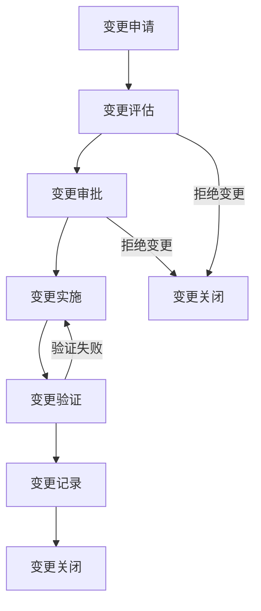
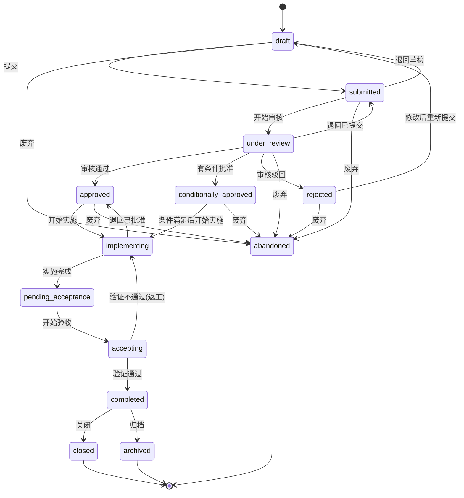

# 变更管理流程规范

## 1. 文档基础信息

**文档标题**：变更管理流程规范
**文档版本**：V2.6.0
**编制日期**: 2026-08-09
**编制人**: Antigravity AI
**审核人**: [审核人姓名]

## 2. 版本变更记录

| 版本号 | 变更内容 | 变更人 | 变更日期 | 详细说明 |
|--------|----------|--------|----------|----------|
| **V2.6.0** | **变更流程只留一份：§10 并进 §5，并入 PM-045 场景示例** | Claude（规范库甲二） | 2026-11-15 | §5.3～5.8、§9、§10、§13.3、§13.4；见 §12 |
| **V2.5.1** | **说法对齐：台账差异不自动修复；补“已废弃”状态** | Claude（规范库甲一） | 2026-11-15 | §3.5 第 2 条、§5.2；见 §12 |
| **V2.5.0** | **分离变更授权与执行连续性状态** | Codex（架构师/PM） | 2026-09-09 | CHG/Decision 管授权，Work/Run/Checkpoint 管执行；接入 PM-056 |
| **V2.4.0** | **基于 008 实践增加台账自动对账与 Retrofit 补单工作流** | Antigravity AI | 2026-08-09 | 增加 `ledger reconcile` 自动对账卡点与 `--retrofit` 紧急/历史补单通道 |
| **V2.3.0** | 对齐auto-pm状态机: 状态命名改为draft/submitted/under_review等，新增conditionally_approved和archived | Trae | 2026-06-21 | [查看详细变更](#2-版本变更记录) |

## 3. 范围

本规范适用于所有**自动化工程项目**的变更管理活动，涵盖以下**7大技术领域**和**5种业务性质**：

### 3.1 技术领域（WHO - 哪个专业？）

| 领域代码 | 领域名称 | 典型交付物 |
|---------|----------|-----------|
| **ELEC** | 电气设计 | Eplan原理图、接线图、IO分配表、BOM清单、柜体布局图 |
| **MECH** | 机械结构 | SolidWorks 3D模型、装配图、加工图、结构件选型表 |
| **PLC** | PLC程序 | IEC 61131-3标准程序(SCL/ST/LD/FBD)、GVL变量表、功能块库 |
| **HMI** | HMI程序 | 触摸屏画面(ProFace/WinCC等)、变量映射表、报警配置、配方管理 |
| **SCPT** | Python脚本 | 数据采集程序、MES接口、上位机应用、工具脚本 |
| **DOCU** | 工程文档 | 设计说明书、操作手册、验收报告、培训材料、维护手册 |
| **SAFE** | 安全功能 | 急停回路设计、安全矩阵、SIL等级评估报告、安全PLC程序 |

### 3.2 业务性质（WHY - 为什么变？）

| 性质代码 | 性质名称 | 说明 | 典型场景 |
|---------|----------|------|----------|
| **REQ** | 需求变更 | 客户/市场/工艺驱动的新增或修改 | 客户新增第四段输送线 |
| **DEF** | 缺陷修复 | Bug修复、故障排除、设计纠错 | 现场调试发现联锁逻辑错误 |
| **OPT** | 优化改进 | 性能提升、可维护性改善、用户体验优化 | 重构FB以降低扫描周期占用 |
| **CFG** | 配置调整 | 参数修改、IO地址调整、通信配置变更 | 传感器更换后调整IO地址和延时参数 |
| **EMRG** | 紧急变更 | 安全相关、生产中断等需立即处理 | 急停回路增加安全继电器 |

### 3.3 影响范围（WHERE - 影响到什么程度？）

| 范围代码 | 范围名称 | 说明 | 审批要求 |
|---------|----------|------|----------|
| **LOCAL** | 局部变更 | 仅影响单个POU/单个画面/单个IO点/单行文档 | 项目经理审批 |
| **MODULE** | 模块级变更 | 影响单个设备/单条线/单个子系统 | 项目负责人审批 |
| **SYSTEM** | 系统级变更 | 影响多模块联动/联锁逻辑/通讯接口/全局变量 | 技术总监审批 |
| **CROSS** | 跨系统变更 | 影响PLC+HMI+电气+机械多个子系统(需关联多张变更单) | 高层管理层审批 |
| **SAFE** | 安全相关变更 | 影响急停回路/SIL等级/安全功能(特殊流程) | 安全负责人+高层联合审批 |

### 3.4 适用项目类型

| 项目类型 | 是否适用 | 说明 |
|---------|----------|------|
| 自动化整线项目(ZD) | ✅ 核心适用 | 多领域集成,变更传播链复杂 |
| 单机设备-机器人版 | ✅ 适用 | 机器人+PLC+HMI+安全多领域 |
| 单机设备-PLC-HMI版 | ✅ 适用 | PLC+HMI+电气+安全 |
| 系统升级项目(XT) | ✅ 适用 | 在原有系统上改造,影响评估尤为重要 |
| 上位机项目(WX) | ⚠️ 部分适用 | 主要涉及SCPT+DOCU,其他领域按需 |
| Python软件开发(SW) | ✅ 向下兼容 | 对应原V1.x的"Python项目",归入SCPT领域 |

### 3.5 变更台账自动化对账 (Reconcile) 规约 (基于008实践)
为了防止变更单 Markdown 文件与全局变更台账 (`change_ledger.json`) 发生脱节：
1. **自动对账触发点**：每当一个变更单状态转为 `closed`，或项目进行版本升级发布前，必须在终端执行：
   ```powershell
   <workspace-python> <workspace-root>/main.py --workspace <workspace-root> ledger reconcile <项目ID>
   ```
2. **对账合格标准**：缺失变更单为 0、悬空记录为 0、状态差异为 0。若存在差异，先报告差异，**不自动修复**：对真台账不加 `--fix`（命令的修复参数叫 `--fix`，没有 `--auto-fix`）；每条差异按变更单处理，处理完再对账。严禁在台账有差异的情况下发布版本。

### 3.6 Retrofit 快捷补单工作流 (先实施后补单)
针对紧急 Bug 修复、历史遗漏补单或纯文档注释更新，提供快捷 Retrofit 工作流：
1. **指令形式**：通过项目声明的 release launcher 调用 `change create --retrofit --pid <项目ID>`，不得依赖 editable install。
2. **状态跳转**：新建的变更单直接跳过 9 步状态流转，初始化即为 `closed` 状态。
3. **元数据要求**：仍需完整记录变更原因、受影响代码/文件清单及验证命令，确保全局可追溯性。

### 3.7 授权状态与执行状态边界

- CHG 与不可变 Decision 是范围和风险的授权真源，回答“是否允许实施、允许改哪些文件”。
- Work、Run、Checkpoint、Handoff 和 lease 是执行连续性真源，回答“由谁、在哪个 Git/worktree、执行到哪里、如何恢复”。
- PM_SESSION 仅作项目摘要投影，不得承载执行队列、lease、current run 或 next action。
- 写入型 Work 的 scope 必须是批准文件的子集；CHG 已批准不等于 Run 已完成，Run 成功也不等于 CHG 已验收关闭。
- 连续性对象、Adapter 和失败关闭规则遵循 [[056_跨Agent工作连续性与恢复协议_PM|PM-056]]；任务派发遵循 PM-046。

## 4. 术语定义

| 术语 | 定义 |
|------|------|
| 变更 | 对项目计划、范围、进度、成本、质量或其他方面的修改 |
| 变更请求 | 正式提出的变更申请 |
| 变更审批 | 对变更请求进行评估和批准的过程 |
| 变更实施 | 执行已批准的变更的过程 |
| 变更验证 | 确认变更是否成功实施的过程 |
| **技术领域** | 变更所属的专业领域(电气/机械/PLC/HMI/Python/文档/安全) |
| **业务性质** | 变更的业务驱动因素(需求/缺陷/优化/配置/紧急) |
| **影响范围** | 变更对系统的影响程度(局部/模块/系统/跨系统/安全) |
| **变更传播链** | 一个领域的变更引发其他领域连锁变更的路径(如:电气→PLC→HMI→文档) |
| **关联变更单** | 因传播效应而需要同步发起的其他变更单编号 |
| **组件(Component)** | 工程项目中的最小可变更单元,如:单个POU/单个IO点/单个画面/单个3D零件/单张图纸 |

## 5. 变更管理流程

### 5.1 流程概览



### 5.2 变更单状态跟踪看板

变更单状态跟踪看板用于可视化展示所有变更单的状态，便于项目经理和相关人员实时掌握变更进展。看板采用看板形式展示，分为以下列：

| 看板列 | 状态标识 | 中文标签 | 说明 |
|--------|----------|----------|------|
| 草稿 | `draft` | 草稿 | 变更单已创建，尚未提交 |
| 已提交 | `submitted` | 已提交 | 变更已提交，等待审核 |
| 审核中 | `under_review` | 审核中 | 变更正在审核中 |
| 已批准 | `approved` | 已批准 | 变更审核通过，完全批准 |
| 有条件批准 | `conditionally_approved` | 有条件批准 | 变更附条件批准，需满足指定条件后方可实施 |
| 已驳回 | `rejected` | 已驳回 | 变更被驳回，可修改后重新提交 |
| 实施中 | `implementing` | 实施中 | 变更正在实施 |
| 待验收 | `pending_acceptance` | 待验收 | 变更实施完成，等待验收 |
| 验收中 | `accepting` | 验收中 | 变更正在验收 |
| 已完成 | `completed` | 已完成 | 变更验收通过 |
| 已关闭 | `closed` | 已关闭 | 变更已关闭（终态，不可再流转） |
| 已归档 | `archived` | 已归档 | 变更已归档（终态，不可再流转） |
| 已废弃 | `abandoned` | 已废弃 | 变更从未实施就放弃（终态，不可再流转），必须附原因 |

**STATUS_LABELS 中文标签映射**（状态和允许的流转以驾驶舱代码 `auto_pm/domain/change/constants.py` 的 `STATUS_LABELS`、`STATUS_FLOW` 为准；本节和代码不一致时按代码，并提变更单改本节）：

| 状态标识 | 中文标签 |
|----------|----------|
| `draft` | 草稿 |
| `submitted` | 已提交 |
| `under_review` | 审核中 |
| `approved` | 已批准 |
| `conditionally_approved` | 有条件批准 |
| `rejected` | 已驳回 |
| `implementing` | 实施中 |
| `pending_acceptance` | 待验收 |
| `accepting` | 验收中 |
| `completed` | 已完成 |
| `closed` | 已关闭 |
| `archived` | 已归档 |
| `abandoned` | 已废弃 |



**conditionally_approved 状态定义：**
- **含义**：变更附条件批准，审批人认为变更基本可行但需满足特定条件后方可实施
- **进入条件**：从 `under_review` 状态，审批结论为"有条件通过"时进入
- **条件说明**：必须在变更单 §8.2 审批结论中明确列出附带条件（如"需补充安全评估报告后方可实施"）
- **允许流转**：`conditionally_approved` → `implementing`（条件满足后开始实施）
- **与 approved 的区别**：`approved` 可直接进入实施；`conditionally_approved` 需确认附带条件已满足

**archived 状态定义：**
- **含义**：变更已完成并归档，作为历史记录保存
- **进入条件**：从 `completed` 状态归档后进入
- **流转规则**：归档后不可再流转，为终态
- **与 closed 的区别**：`closed` 适用于被驳回或未实施的变更关闭；`archived` 适用于已完成变更的归档

**abandoned 状态定义：**
- **含义**：变更还没开始实施就决定不做了，作为终态留档
- **进入条件**：从 `draft`、`submitted`、`under_review`、`approved`、`conditionally_approved`、`rejected` 进入，必须附原因
- **不允许**：已经开始实施的（`implementing` 及以后）不能直接废弃，应走返工或验收
- **流转规则**：终态，不可再流转，也不能凭它批准决策或提交代码

**看板交互规则：**
1. 变更单只能向前移动到相邻状态，不能跳跃（例外：§3.6 Retrofit 补单创建时直接落 `closed`；未实施的单可以直接废弃到 `abandoned`）
2. 变更单可以被驳回或打回，需要记录原因
3. 验收不通过时，变更单返回实施阶段重新实施
4. `closed`、`archived` 和 `abandoned` 是最终状态，不可再流转
5. `rejected` 状态可修改后重新提交（`rejected` → `draft`）

### 5.3 变更申请

1. **变更申请人**：项目团队成员、客户或其他相关方
2. **申请流程**：
   - **代码基探路先行 (Step 0: Codebase Reconnaissance)**：对于在研项目，在发起变更申请前必须先执行代码基逆向与事实检索（通过工具检索或派发 Grooming 预研子代理），提取受影响文件、现有变量名与接口逻辑，严禁未经代码查验直接向用户盲目发问。
   - 填写变更单（用 [040 变更单模板](040_通用变更单模板_CHG.md)），详细描述变更原因、变更内容（引用具体代码位置与数据结构）和变更影响
   - 写明变更优先级和期望完成时间
   - 提交变更单给项目经理，并通知相关人员变更申请已提交

### 5.4 变更评估

1. **评估人员**：项目经理、技术负责人、相关团队成员；项目经理任评估负责人，技术负责人评估技术可行性，相关团队成员评估变更影响
2. **评估内容**：
   - 变更的必要性和合理性
   - **代码基事实一致性**：核验变更单引用的源码路径、变量名与接口定义是否在代码库中真实存在
   - 变更对项目范围、进度、成本、质量的影响
   - 变更的可行性和风险
   - **影响分析**：系统自动分析受影响的组件、风险等级和缓解措施
   - **跨领域影响评估**（V2.0新增）: 必须识别变更是否会影响其他技术领域,如:
     - 电气IO点位变化 → 是否影响PLC程序和HMI画面？
     - 机械结构修改 → 是否影响传感器安装位置和电气布线？
     - PLC程序逻辑变更 → 是否影响HMI显示和安全功能？
     - 安全回路修改 → 是否需要安全负责人专项审批？
3. **评估结果**：
   - 接受变更
   - 拒绝变更
   - 要求补充信息后重新评估
   - 评估结论形成书面评估报告，写明结论和建议，附上影响分析结果
4. **影响分析要求**：
   - 所有变更必须进行影响分析
   - 影响分析结果需记录在变更单中；系统自动分析的结果必要时可以手动调整
   - 风险等级分为：低（LOW）、中（MEDIUM）、高（HIGH）
   - 必须制定相应的缓解措施

### 5.5 变更审批

1. **审批人员**：根据变更的影响程度，由不同级别的人员审批
   - 轻微变更：项目经理审批
   - 中等变更：项目负责人审批
   - 重大变更：高层管理层审批
2. **审批流程**：
   - 审批人员审核变更评估结果
   - 签署审批意见
   - 通知变更申请人和相关团队成员
3. **审批历史记录**：
   - 所有审批操作必须记录审批历史
   - 审批历史包括：审批人、审批动作（通过/驳回）、审批意见、审批时间
   - 审批历史不可删除，只能追加
   - 审批历史对变更申请人和相关团队成员可见

### 5.6 变更实施

1. **实施人员**：相关团队成员
2. **实施流程**：
   - 制定变更实施计划：写明实施步骤和责任人，确定实施时间和资源需求，制定风险应对措施
   - 按实施计划执行变更，及时沟通实施进展
   - 记录变更实施过程，包括实施中遇到的问题和解决方案
   - 实施完成后确认完成，并通知相关人员实施情况
3. **实施要求**：
   - 确保变更不会影响其他项目活动
   - 确保变更符合项目质量标准
   - 及时沟通变更实施情况

### 5.7 变更验证

1. **验证人员**：项目经理、技术负责人、质量保证人员；项目经理任验证负责人，技术负责人验证技术实现，质量保证人员验证质量
2. **验证内容**：
   - 变更是否按照批准的内容实施
   - 变更是否达到预期效果
   - 变更是否对其他项目活动产生负面影响
3. **验证结果**：
   - 验证通过
   - 验证失败，需要重新实施
   - 形成书面验证报告，写明验证结论

### 5.8 变更记录

1. **记录内容**：
   - 变更单编号和基本信息
   - 变更评估结果
   - 变更审批意见
   - 变更实施记录
   - 变更验证结果
2. **记录方式**：
   - 变更单存档 (每个变更一份独立档案, 存放在01_变更单/对应领域子目录)：按 [043 目录结构说明](./043_通用变更管理目录结构说明_PM.md) 放在 `01_变更单/CHG-[DOMAIN]/`，命名 `CHG-[DOMAIN]-[YYYY]-XXX.md`，记录完整的变更生命周期（变更单 §1～§10）
   - 版本变更台帐记录 (引用模式, 每行指向独立变更单)：用 [041 版本变更台账模板](041_通用版本变更台账模板_CHG.md)，在台账 §4 追加一行引用（含超链接到变更单文件）
   - 项目状态报告中反映，确保项目计划与变更保持一致
   - 需要变更报告时，用 [050 验收核验报告模板](../05_收尾验收/050_通用验收核验报告模板_PM.md)（原 044 变更报告模板已除名），总结变更实施情况和验证结果

## 6. 变更管理角色与职责

| 角色 | 职责 | 典型人员 |
|------|------|----------|
| 变更申请人 | 提出变更请求，提供变更相关信息 | 任何项目成员(电气/机械/PLC/HMI工程师等) |
| 项目经理 | 接收变更请求，组织变更评估，协调跨领域变更实施 | PM |
| 技术负责人 | 评估变更的技术可行性和影响 | Tech Lead / 架构师 |
| **领域专家** | **评估本领域的变更影响和实施方案** | **电气工程师/机械工程师/PLC工程师/HMI工程师/安全负责人** |
| 审批人 | 审批变更请求，确保变更符合项目目标 | 按影响范围分级(见§3.3) |
| 实施人员 | 执行已批准的变更 | 对应领域的工程师 |
| 验证人员 | 验证变更是否成功实施(含跨领域联动验证) | QA + 相关领域工程师 |

## 7. 变更管理工具

| 工具名称 | 用途 | 当前版本 |
|---------|------|:-------:|
| 变更单模板 | 用于填写变更请求 | [040_CHG](040_通用变更单模板_CHG.md) |
| 版本变更台账 | 用于记录变更历史(引用模式) | [041_CHG](041_通用版本变更台账模板_CHG.md) |
| 目录结构说明 | 定义目录组织方式(精简版) | [043_PM](./043_通用变更管理目录结构说明_PM.md) |
| 项目管理软件 | 用于跟踪变更状态 | - |
| 文档管理系统 | 用于存储变更相关文档 | - |

## 8. 变更管理指标

| 指标名称 | 定义 | 计算方法 | 目标值 |
|---------|------|----------|--------|
| 变更响应时间 | 从变更申请到变更审批的时间 | 变更审批日期 - 变更申请日期 | ≤ 3个工作日 |
| 变更实施时间 | 从变更审批到变更实施完成的时间 | 变更实施完成日期 - 变更审批日期 | 根据变更复杂度而定 |
| 变更成功率 | 验证通过的变更数量与总变更数量的比率 | 验证通过的变更数量 / 总变更数量 × 100% | ≥ 95% |
| 变更对项目的影响程度 | 变更对项目范围、进度、成本的影响 | 通过变更影响分析评估 | 最小化 |

## 9. 变更管理最佳实践

1. **变更前置**：在项目规划阶段就考虑可能的变更，预留变更空间
2. **变更评估**：对所有变更进行充分评估，避免不必要的变更
3. **变更审批**：严格执行变更审批流程，确保变更得到适当的授权
4. **变更沟通**：及时沟通变更信息，确保所有相关方了解变更情况
5. **变更记录**：详细记录变更过程，便于追溯和分析
6. **变更学习**：总结变更经验教训，持续改进变更管理流程
7. **模板使用**：统一使用标准化的模板，确保文档格式一致
8. **培训与检查**：向团队成员培训变更管理流程和模板使用方法，定期检查流程执行情况，根据实际使用情况持续改进流程和模板

## 10. 实施指南

> V2.6.0 起，原 10.1～10.6（申请、评估、审批、实施、验证、记录六步的做法）是 §5.3～5.8 的第二遍，已并进 §5：只在这里有的条目（优先级和期望完成时间、评估负责人、书面评估报告、实施计划的责任人和资源、书面验证报告、变更单存放和命名、台账 §4 追加引用）搬到 §5 对应小节，其余删除。逐条去向见 §12 V2.6.0。下面 10.7 不动。

### 10.7 常见问题解决方案

| 问题 | 解决方案 | 示例 |
|------|---------|------|
| 变更评估不充分 | 建立评估 checklist，确保评估内容全面 | 使用标准化的评估表格 |
| 变更审批延迟 | 设定审批时限，建立催办机制 | 对超过3个工作日未审批的变更进行催办 |
| 变更实施偏差 | 严格按照变更单执行，定期检查实施进度 | 每日更新变更实施状态 |
| 变更验证不严格 | 建立验证标准，确保验证内容完整 | 使用标准化的验证表格 |
| 变更记录不完整 | 建立记录模板，确保记录内容全面 | 使用标准化的变更记录模板 |

## 11. AI辅助开发场景的变更管理

> **新增于 V2.1.0** | 来源项目: SW-2026-004 Python项目管理工具 (AI辅助开发经验)

本章节针对AI辅助开发（如Trae、Copilot等工具）引入的3个典型自动化场景，提供专门的变更管理流程和简化规则。

### 11.1 AI辅助代码生成场景

**适用范围**: 当使用AI工具(Trae/Copilot等)批量生成或修改代码时

**变更流程**:

0. **代码基探路与上下文抽取 (Step 0: Codebase Reconnaissance)**
   - 使用文件/内容搜索工具，或按 PM-046 创建 read-only Work 并派发结构化 Grooming Handoff，勘测已有源码与数据结构
   - 严禁向用户询问代码中已有的参数、变量名或逻辑关系

1. **生成前准备**
   - 确认AI生成的代码遵循当前有效的规范版本号
   - 在生成请求中明确指定规范版本(如"基于905_SCL编程规范_V1.0.1")

2. **生成后审查**
   - 对比AI输出与规范的差异点
   - 将差异项记录为"AI生成偏差清单"

3. **变更审批**
   - 差异项<5处: 开发者自审即可合并
   - 差异项5~20处: 需要同行评审
   - 差异项>20处: 必须重新生成并回归验证

### 11.2 批量规范同步场景

**适用范围**: 当全局规范仓库更新后需要同步到多个在研项目时

**操作步骤**:

1. 规范管理员发布新版规范到全局仓库
2. 各项目负责人接收"规范更新通知"
3. 项目组评估影响范围(高/中/低):
   - 高影响: 必须在下一迭代前完成同步
   - 中影响: 可在2个迭代窗口内完成
   - 低影响: 可延后到下一个大版本
4. 同步完成后在项目中创建"规范同步记录"

### 11.3 自动化测试触发场景

**适用范围**: 当CI/CD流水线自动运行测试套件时发现规范偏差

**简化规则**:

| 测试类型 | 触发条件 | 变更单创建规则 | 审批要求 |
|---------|---------|---------------|---------|
| 单元测试 | 测试失败且与规范相关 | 自动创建变更单 | 无需人工初审 |
| 集成测试 | 测试失败 | 开发者确认后创建变更单 | 需开发者确认 |
| 回归测试 | 测试失败 | 必须升级为"紧急变更" | 按EMRG流程处理 |

## 12. 版本详细变更说明

### V2.6.0 版本详细变更
1. 原 §10.1～10.6 并进 §5.3～5.8：§10.1“明确变更优先级和期望完成时间”“通知相关人员变更申请已提交”→ §5.3；§10.2“项目经理作为评估负责人”“形成书面评估报告，明确评估结论和建议”→ §5.4；§10.3 与 §5.5 相同，删；§10.4“明确实施步骤和责任人、实施时间和资源需求、风险应对措施”“及时沟通实施进展”“记录实施中的问题和解决方案”“确认实施完成并通知”→ §5.6；§10.5“项目经理作为验证负责人”“形成书面验证报告，明确验证结论”→ §5.7；§10.6 存放路径、命名规则、记录完整生命周期、台账 §4 追加引用、项目计划与变更保持一致 → §5.8。§10.7 常见问题表不动。
2. PM-045《变更管理流程执行指南》归冷（`Archive_Cold/01_项目管理域/04_变更管理/`）：它的三个典型工程变更场景示例和快速参考卡原样搬进 §13.3、§13.4；§5.2“必要时手动调整影响分析结果”“附上影响分析结果”→ §5.4；§5.6“生成变更报告”→ §5.8（报告用 050 模板）；§7 第 5 条“模板使用”、§9“培训、检查、改进”→ §9 第 7、8 条；其余与本规范重复或已过时，逐条去向见规范库甲二变更单的对照表。

### V2.5.1 版本详细变更
1. §3.5 第 2 条：台账有差异时先报告、不自动修复；原文“必须先执行自动修复 (`--auto-fix`)”与“不对真台账跑 `--fix`”的规矩相反，且命令里没有 `--auto-fix`，实际参数是 `--fix`。
2. §5.2：补 `abandoned`（已废弃）状态、进入条件和状态图；“不能跳跃”补 Retrofit 和废弃两个例外；“与 auto-pm 一致”改为“以代码 `constants.py` 为准”。

### V2.5.0 版本详细变更
1. 新增 §3.7，明确 CHG/Decision 与 Work/Run 的职责边界。
2. 接入 PM-056 连续性协议和 PM-046 结构化 Handoff。
3. 将当前操作入口改为平台中立 release launcher 表述。

<a name="v100"></a>
### V1.0.0 版本详细变更
1. 初始版本创建
2. 定义变更管理流程的基本规范
3. 提供详细的变更管理流程和角色职责

<a name="v110"></a>
### V1.1.0 版本详细变更
1. 优化变更管理流程规范
2. 添加文档基础信息部分
3. 改进版本变更记录格式
4. 增加版本详细变更说明部分

<a name="v200"></a>
### V2.0.0 版本详细变更 (重大升级)
1. **范围扩展**: 从"Python项目"升级为"自动化工程项目",覆盖7大技术领域+5种业务性质+5级影响范围
2. **术语增强**: 新增6个工程变更专用术语(技术领域/业务性质/影响范围/传播链/关联变更单/组件)
3. **影响分析升级**: §5.4新增跨领域影响评估要求,强制识别变更传播链
4. **角色扩展**: §6新增"领域专家"角色,明确各工程专业在变更中的职责
5. **工具引用升级**: §7所有模板引用已更新为最新版本号(V2.0/V2.1)
6. **记录方式升级**: §5.8明确引用模式(变更单=档案, 台帐=索引)
7. **向下兼容**: 保留原有流程框架,Python软件开发项目可通过SCPT领域继续使用

<a name="v210"></a>
### V2.1.0 版本详细变更 (增强)
1. **新增AI辅助开发场景章节**: §11完整新增,涵盖3个自动化场景的专用变更管理流程
2. **AI辅助代码生成场景** (§11.1): 定义生成前准备→生成后审查→分级审批的完整流程,按差异项数量(</5/5-20/>20)设置三级审批门槛
3. **批量规范同步场景** (§11.2): 建立全局仓库→项目接收→影响评估(高/中/低)→同步记录的标准化操作步骤
4. **自动化测试触发场景** (§11.3): 针对CI/CD流水线制定简化规则,单元测试自动创建变更单、集成测试需确认、回归测试升级紧急流程
5. **来源追溯**: 所有新增内容基于SW-2026-004项目的AI辅助开发实践经验提炼

<a name="v220"></a>
### V2.2.0 版本详细变更 (对齐auto-pm状态机)
1. **§5.2 状态机命名全面对齐auto-pm**: 将旧状态标识(pending_analysis/analyzing/pending_approval/approving/pending_implementation)替换为auto-pm实际使用的状态标识(draft/submitted/under_review/approved/implementing)
2. **新增 conditionally_approved 状态**: 从 under_review → conditionally_approved，审批结论为"有条件通过"时进入，需满足附带条件后方可流转到 implementing
3. **新增 archived 状态定义和流转规则**: completed → archived，归档后不可再流转，为终态；与 closed 区分（closed 适用于驳回/未实施的关闭，archived 适用于已完成变更的归档）
4. **新增 STATUS_LABELS 中文标签映射表**: 与 auto-pm models.py 中的 STATUS_LABELS 完全一致
5. **rejected 流转调整**: rejected → draft（修改后重新提交），替代旧的 rejected → closed

## 13. 附录

### 13.1 参考资料
| 资料名称 | 版本 | 来源 |
|----------|------|------|
| 项目管理知识体系指南 | [版本] | [来源] |
| 变更管理最佳实践 | [版本] | [来源] |
| 软件工程标准 | [版本] | [来源] |

### 13.2 联系方式
| 角色 | 姓名 | 邮箱 | 电话 |
|------|------|------|------|
| 文档负责人 | [姓名] | [邮箱] | [电话] |
| 技术负责人 | [姓名] | [邮箱] | [电话] |

### 13.3 典型工程变更场景示例

> V2.6.0 从 PM-045（已归冷）§7 原样搬来。示例里的“§6.2”“§6.3”是写示例时变更单模板的章节号，不是本规范的章节；三个场景的标题从三级降为四级，正文一字没改。

> **以下3个场景展示了自动化工程项目中典型的跨领域变更链路,帮助理解V2.0规范的二维分类和传播链概念。**

#### 场景A: 传感器位置调整（典型的跨领域变更链）

```
变更背景:
  现场安装时发现光电传感器位置偏差10mm,无法可靠检测1300×700mm玻璃到位
变更性质: DEF (缺陷修复 - 现场安装问题)
影响范围: CROSS (跨系统 - 涉及4个领域)

变更链路图:
  ┌─────────┐    ┌─────────┐    ┌─────────┐    ┌─────────┐
  │ MECH    │ →  │ ELEC    │ →  │ PLC     │ →  │ DOCU    │
  │ 支架孔位 │    │ 预配线长 │    │ IO地址+  │    │ 文档同步 │
  │ 调整10mm│    │ 度调整   │    │ 参数适配 │    │ 修订     │
  └─────────┘    └─────────┘    └─────────┘    └─────────┘

步骤详解:
  Step 1: 发起 CHG-MECH-001 (主变更单)
          技术领域=MECH, 性质=DEF, 范围=CROSS
          内容: 机械支架安装孔位需从原位置偏移10mm

  Step 2: 影响评估(§6.2)发现电气受影响 → 关联 CHG-ELEC-002
          技术领域=ELEC, 性质=CFG (配置调整)
          内容: 传感器预配线长度需增加15cm,可能需要更换线号

  Step 3: CHG-ELEC-002评估发现IO点位可能变化 → 关联 CHG-PLC-003
          技术领域=PLC, 性质=CFG
          内容: 若传感器型号/接线方式变化,需更新GVL中的AT地址映射;
                可能需要微调i_SlowDelayTime参数以适应新检测位置

  Step 4: CHG-PLC-003评估发现HMI可能受影响 → 关联 CHG-HMI-004
          技术领域=HMI, 性质=CFG
          内容: HMI画面上的传感器位置示意图需更新;
                若有传感器状态显示页,变量映射需确认

  Step 5: 全部关联变更完成后 → 关联 CHG-DOCU-005
          技术领域=DOCU, 性质=OPT (文档同步)
          内容: 更新IO分配表/联锁逻辑文档/操作手册中的传感器位置说明

  Step 6: 全链路验证(§6.3)
          [MECH完成]→[ELEC验证通过]→[PLC验证通过]→[HMI验证通过]→[DOCU验证通过]
          现场带料测试: 送入玻璃板,确认新位置传感器可靠触发

关键经验:
  - 机械小改动可能引发4个领域的连锁变更
  - 每个环节都应有独立的变更单和验证
  - 最终必须做端到端的现场验证
```

#### 场景B: 变频器型号替换（硬件驱动软件变更）

```
变更背景:
  原定汇川变频器缺货,需替换为台达品牌同功率型号
变更性质: CFG (配置调整 - 供应商变更)
影响范围: SYSTEM (系统级 - 涉及PLC+电气协调)

差异对比:
  | 项目 | 原变频器(汇川) | 新变频器(台达) |
  |------|--------------|--------------|
  | 功率规格 | 1.5kW | 1.5kW (相同) |
  | 控制方式 | 端子启停 + 0-10V模拟量调速 | 相同 ✅ |
  | 故障输出 | 1NO+1NC继电器 | 1NO+1NC继电器 ✅ |
  | 通信协议 | Modbus RTU (可选) | Modbus RTU (可选) ✅ |
  | 参数设置 | Acc系列菜单 | VFD-E系列菜单 ❌ |

变更链路:
  ┌─────────────┐         ┌─────────────┐
  │ ELEC        │ ←─────── │ PLC         │
  │ 变频器参数   │  参数对齐 │ 通信地址    │
  │ 配置不同    │         │ 映射可能变  │
  └─────────────┘         └─────────────┘

步骤:
  Step 1: CHG-ELEC-010 (主变更)
          技术领域=ELEC, 性质=CFG, 范围=SYSTEM
          内容: 变频器型号从汇川AC300替换为台达VFD-E,
                需重新配置加速时间/减速时间/转矩补偿等参数

  Step 2: 评估是否需要CHG-PLC-011
          如果使用了变频器通讯功能(读取频率/故障码):
            → 需要检查Modbus寄存器地址映射是否兼容
            → 如不兼容,发起CHG-PLC-011修改通信程序
          如果仅使用端子+模拟量(本项目DJ-2026-014的情况):
            → 无需PLC变更,在CHG-ELEC-010的§6.2标注"PLC不受影响"

  Step 3: 验证
          空载测试: 启停控制正常,速度给定0-100Hz线性对应
          带载测试: 输送玻璃板运行平稳,无异常振动

关键经验:
      不是所有硬件替换都会引发软件变更,需要具体分析
      "影响评估"环节的核心价值在于判断是否真的需要关联变更
```

#### 场景C: 急停回路增加安全继电器（安全相关变更 - 特殊流程）

```
变更背景:
  客户第三方安全审核要求,急停回路必须增加安全继电器(如PILZ PNOZ),
  以符合ISO 13849-1 PLd / IEC 61508 SIL2等级
变更性质: EMRG (紧急/安全相关)
影响范围: SAFE (安全相关 - 最高审批级别)

⚠️ 此类变更走特殊流程:
  - 必须由安全负责人专项审批(不可用普通PM审批替代)
  - 需要单独的安全功能风险评估(SRA)
  - 验证必须包含安全功能测试(SFT)

变更链路:
  ┌──────────┐    ┌──────────┐    ┌──────────┐
  │ ELEC     │ →  │ PLC      │ →  │ DOCU     │
  │ 安全继电器│   │ 安全输入  │   │ 安全矩阵 │
  │ 回路改造 │   │ 点增加   │   │ 更新     │
  └──────────┘    └──────────┘    └──────────┘

步骤:
  Step 1: CHG-SAFE-020 (主变更 - EMRG性质)
          技术领域=ELEC(主)+SAFE, 性质=EMRG, 范围=SAFE
          审批人: 安全负责人 + 项目经理联合签字
          内容: 急停回路增加PNOZ安全继电器,重新布线,
                硬件成本增加约¥800,工期延长2天

  Step 2: 安全风险评估(SRA)
          识别新增风险点: 安全继电器自身故障模式
          缓解措施: 选用带诊断功能型号(PNOZ safety relay),
                      增加安全继电器状态反馈到PLC(DI点)

  Step 3: 关联 CHG-PLC-021 (如需安全反馈)
          技术领域=PLC+SAFE, 性质=DEF
          内容: GVL新增X_SafetyRelay_OK输入点,
                PRG_Main中增加安全回路状态监视逻辑,
                q_StatusWord新增"安全回路故障"编码

  Step 4: 关联 CHG-DOCU-022
          技术领域=DOCU+SAFE, 性质=REQ
          内容: 更新安全矩阵文档(§10安全设计章节),
                更新电气原理图(急停回路部分),
                更新验收标准(增加SIL2合规性测试项)

  Step 5: 安全功能测试(SFT) - 特殊验证要求
          测试1: 急停按下 → 安全继电器立即动作(<50ms) → PLC检测到信号丢失
          测试2: 安全继电器故障模拟 → 系统进入安全状态(不可复位启动)
          测试3: 复位序列验证 → 解除急停 → 安全继电器复位 → PLC检测到恢复 → 允许启动

关键经验:
      安全相关变更(EMRG+SAFE组合)是最高优先级
      必须有安全负责人参与全流程
      验证不能只看"功能正常",必须证明"失效时也安全"(Fail-Safe)
```

### 13.4 工程变更快速参考卡

> V2.6.0 从 PM-045（已归冷）§8 原样搬来。

| 变更场景 | 典型领域 | 典型性质 | 典型范围 | 是否常涉及传播 | 审批层级建议 |
|---------|----------|----------|----------|:------------:|-------------|
| 传感器更换/移位 | MECH/ELEC | DEF/CFG | MODULE~CROSS | ✅ 常见(2-4领域) | PM |
| 变频器/电机更换 | ELEC | CFG | MODULE~SYSTEM | ⚠️ 有时(看是否用通讯) | Tech Lead |
| IO地址调整 | PLC/ELEC/HMI | CFG | MODULE | ✅ 常见(PLC→HMI联动) | PM |
| 联锁逻辑修改 | PLC | DEF/OPT | SYSTEM | ⚠️ 有时(若HMI有报警页) | Tech Lead |
| HMI画面新增 | HMI/PLC | REQ | LOCAL~MODULE | ⚠️ 有时(需PLC提供变量) | PM |
| 急停/安全回路 | ELEC/PLC/SAFE | **EMRG** | **SAFE** | ✅ 总是(至少ELEC+PLC+DOCU) | **Safety+高层** |
| 机械结构大改 | MECH | REQ | CROSS | ✅ 总是(机械→电气→PLC→全部) | 高层管理 |
| 文档修订 | DOCU | OPT/REQ | LOCAL | ❌ 很少(纯文档) | PM |

---

**文档版本**: V2.6.0
**编制日期**: 2026-06-21
**编制人**: Codex（架构师/PM，基于 V2.4.0 增量修订）
**审核人**: [审核人姓名]
