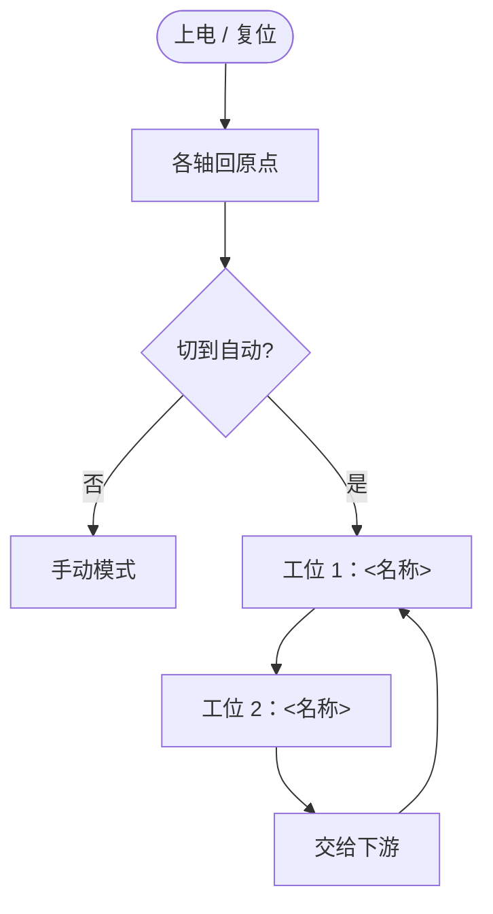
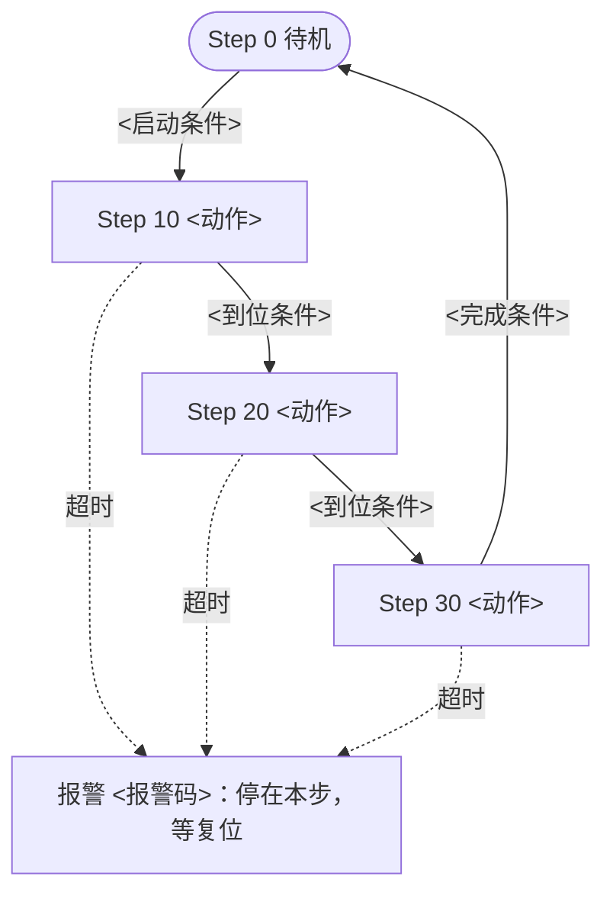

# 工艺流程图 - <项目号> <项目名>

> 每个工位一张 Mermaid 流程图，再配一张步序表。图给人看全貌，表是写程序和调试的依据，两者必须一一对应。
> 步号和程序里的步序变量（例如 `s_iStep`）完全一致；步号跳着编（0、10、20……），留出插步的空位（STD-850）。
> 每一步都写超时时间和超时报警码，不允许“无限等待”的步（STD-850 防卡死、STD-860 首出报警）。
> 图用 Mermaid 写在本文件里，Obsidian 和 GitHub 都能直接显示；画法见规范 TOOL-906。

## 1. 全机流程

## 2. 工位 <编号>：<名称>

### 2.1 流程图

### 2.2 步序表

| 步号 | 步名称 | 本步输出（动作） | 转移条件（去下一步） | 下一步 | 超时（ms） | 超时报警码 | 备注 |
|---|---|---|---|---|---|---|---|
| 0 | 待机 | 全部输出复位 | <启动条件> | 10 | — | — | |
| 10 | | | | 20 | | | |
| 20 | | | | 30 | | | |
| 30 | | | | 0 | | | |

### 2.3 联锁与互锁

| 条件 | 不满足时的动作 |
|---|---|
| 急停 / 安全门 | 立即停止所有输出 |
| <工位间互锁，例如“工位 2 未取走前工位 1 不放料”> | |

### 2.4 节拍

| 段 | 目标时间 | 实测时间 | 备注 |
|---|---|---|---|
| 单个循环 | | | |

## 3. 待确认

| # | 问题 | 该问谁 |
|---|---|---|
| Q1 | | |
