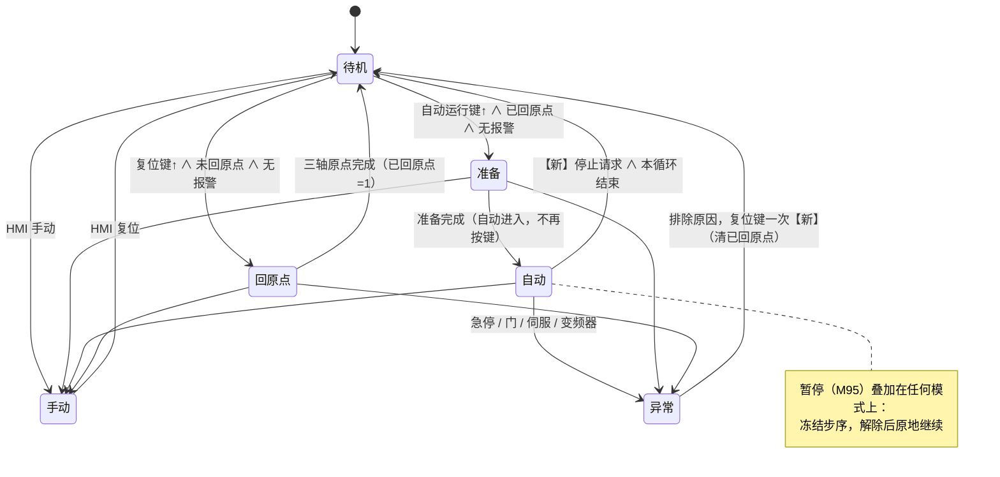
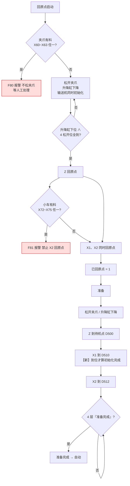
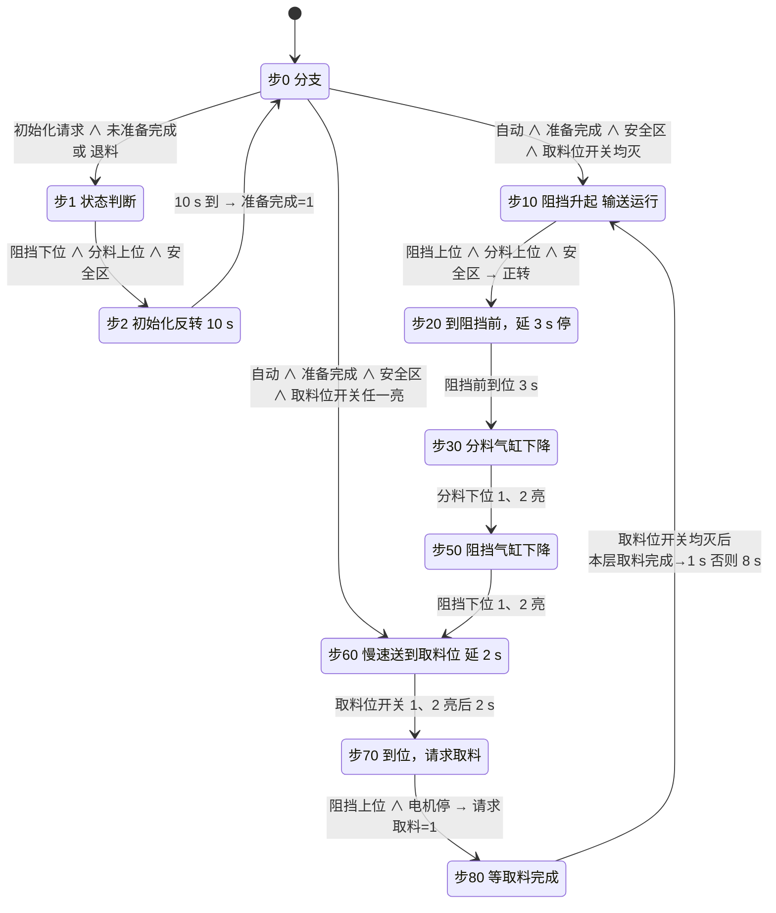
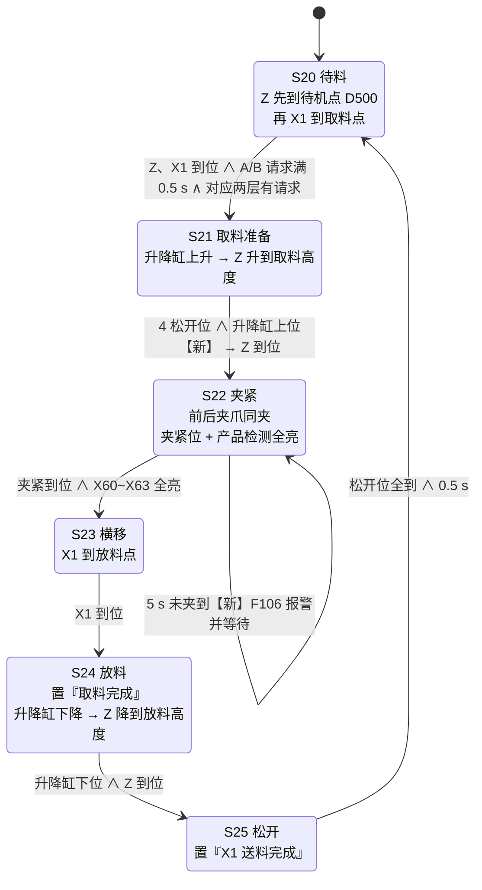
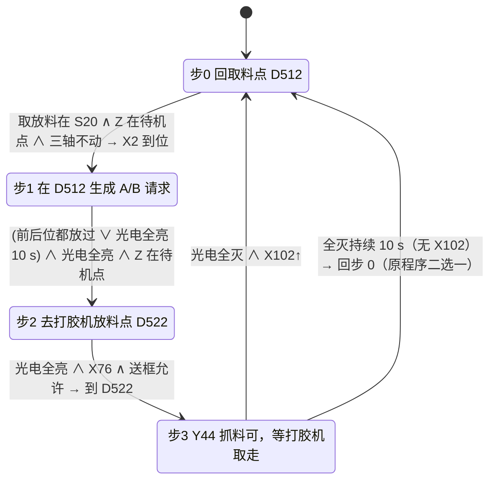
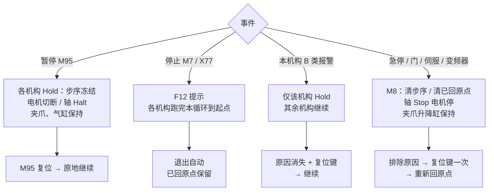

# 边框缓存机自动工艺流程图

## 1. 文档基础信息

- **文档版本**：V3.0.0
- **编制日期**：2026-10-24
- **编制人**：Claude（用户待审）
- **依据**：[PRC](020_原程序工艺说明_PRC.md)（原程序）、[DSN](详细设计说明书_DSN.md)（新设计）。图中“【新】”表示相对原程序的修正或新增，其余沿用。

## 2. 版本变更记录

| 版本 | 变更 | 日期 |
|---|---|---|
| V3.0.0 | 全部重画：旧 V2.x 把输送机画成 9 步、小车画成 D610 / D620 / D630、取放料画成 4 组夹爪，与原程序不符 | 2026-10-24 |

## 3. 整机工艺总览

要点：4 层叠放（每层 2500 × 2500 × 200 mm）；夹爪 1~4 从左到右；前位抓 3、4 层，后位抓 1、2 层；成对取料（单次取料不在 005 做）。

## 4. 模式状态图（FB_1001）

## 5. 回原点与准备（FB_1005）

任何非提示类报警：回原点撤销，排除后“从头再回”当前步。

## 6. 4 层输送机单层状态机（FB_1002，10 步）

并行：满料 1 ∧ 2 ∧ 正转 → 慢速；缺料（正转连续 10 s 且阻挡前、取料位均无料）→ 本层 F100~F103；气缸位置 5 s 报警；暂停时电机切断、步序保持、定时器清零；异常 / 退料 → 步 0、阻挡 / 分料升起。

## 7. 取放料 S20~S25（FB_1003）

对号：A（前位）= 3、4 层；B（后位）= 1、2 层，`iPair` 在 S20 选定并锁存到 S25。暂停 / Hold：轴 `Halt`，恢复后在当前步重新定位；夹爪与升降缸保持。M8：步序回 0，**夹爪不松**。

## 8. X2 送料小车（FB_1004，D760 四步）

送框允许 = ¬M501 ∨ M502 ∨ M510（单套）。X76 只在出发时判一次。Y47 = X2 在 D512 ∧ 不在驱动 ∧ 自动。

## 9. 暂停 / 停止 / 报警 / 急停

## 10. 小结（与旧版图的关键更正）

| 项 | 旧图（Trae） | 本版 |
|---|---|---|
| 输送机 | 9 步 | 10 步（0/1/2/10/20/30/50/60/70/80） |
| 小车 | D610/D620/D630 | D760 四步（0~3），点位 D512 / D522 |
| 取放料 | 4 组夹爪 | 前后各 2 爪，成对取（前位 3+4，后位 1+2） |
| 停止 | 冻结 | 本循环结束后退出自动【新】 |
| M8 恢复 | 按两次 | 按一次【新】 |
