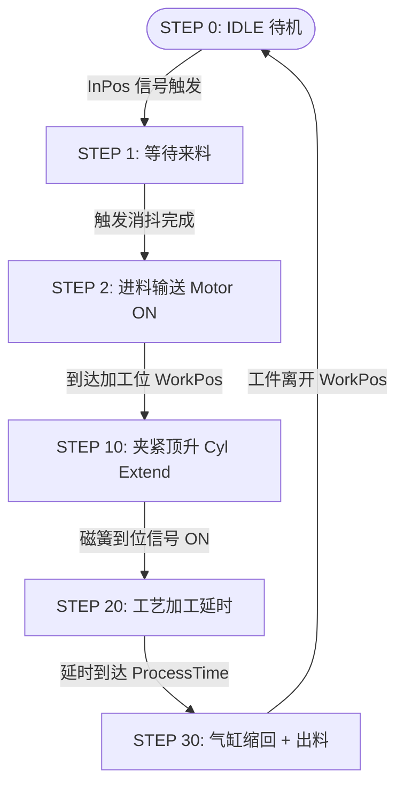

# FB_1001_Station1 详细设计说明书

> **项目编号**: DJ-2026-009  
> **功能块**: `FB_1001_Station1`  
> **模块名称**: 工位1 动作机构控制  
> **版本号**: V1.0.0  
> **编制人**:   
> **更新日期**: 2026-08-23  
> **规范依据**: DEV-001 / LSP-905 / LSP-907  

---

## 1. 状态机设计

---

## 2. 安全联锁与异常保护

1. **超时诊断**:
   - 进料运行超过 10.0s 触发 `AlarmCode := 101`;
   - 气缸夹紧顶升超过 `dCylTimeoutMs` (默认 5s) 触发 `AlarmCode := 102`;
   - 气缸松开下降超过 `dCylTimeoutMs` (默认 5s) 触发 `AlarmCode := 103`。
2. **防死锁 ELSE**:
   - 异常状态号强制重置为 `STEP_IDLE (0)`。

## 3. 与 FB_3001 握手的分工（CARD-DJ-2026-009-003 草稿）

- 本块只给出状态：等待来料 `stStatus.bWaitMaterial`、加工完成可出料 `stStatus.bReadyOut`（出料步且两个气缸都已松开）。OB1 把这两个状态接到 FB_3001 的 `i_bMachineReadyIn` / `i_bMachineReadyOut`，由 FB_3001 统一发握手信号，通讯故障、锁、空 ID 等联锁都在 FB_3001 里。
- 本块不再直接写 `bMachine_ReadyIn` / `bMachine_ReadyOut`。
- 已知未处理（另开卡）：出料步电机不等下游“允许出料”就转；握手中途中止时本块的进/出料电机不停。见预做分支说明。

