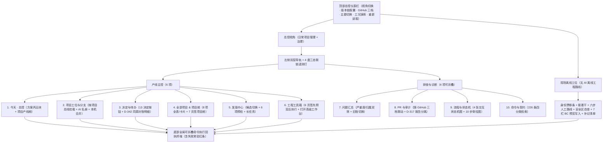

# SW-2026-008 驾驶舱总控屏（cockpit_board）GUI 重设计方案

> **定位与原则**：本文档针对您当前日常双击打开的现行主界面 [`scripts/cockpit_board/`](../scripts/cockpit_board/README.md)（PySide6 桌面总控屏，对应 [双击打开驾驶舱看板.bat](../../../../00_Infrastructure/auto_pm/environment/双击打开驾驶舱看板.bat)）执行**「画面先行」**重设计。
> 本轮严格遵循：**100% 保留全部现有功能与治理安全红线 + 彻底诊断并修复现行界面与 V4 参考原型的不规范之处 + 适配已落地的单机本地优先架构（GH-001 / FLOW-001 / PM-056 V2.0.0）**。不修改 `scripts/cockpit_board/` Python 源码，待您评审原型拍板后再分阶段实施代码改造。

---

## 1. 现行总控屏与参考原型的 8 大不规范诊断

经对现行 [`scripts/cockpit_board/`](../scripts/cockpit_board/) 全量源码及您提供的 V4 概念参考原型逐行勘测，识别出以下 8 项结构性、规范性与交互问题：

### 1.1 现行 `cockpit_board` 的 7 大现状问题（附源码证据）

| # | 问题类别 | 现象与真实源码证据 | 影响 |
|---|---|---|---|
| **1** | **信息架构碎片化与多处重影** | [`shell.py:40-55`](../scripts/cockpit_board/shell.py#L40-L55) 侧栏 3 组平铺了 13 个可见页 + 1 个隐藏页（`project`）：① [`attention.py`](../scripts/cockpit_board/widgets/attention.py)「要你出手」与 [`decisions.py`](../scripts/cockpit_board/widgets/decisions.py)「决定」高度重影（后者已包含待批准范围卡与收件箱，前者只有只读计数）；② [`tasks.py:74`](../scripts/cockpit_board/widgets/tasks.py#L74) 硬编码只读单个 `--station-project` 无法切换项目，且与 [`project_page.py`](../scripts/cockpit_board/widgets/project_page.py)「卡片」页签割裂；③ [`flow.py`](../scripts/cockpit_board/widgets/flow.py)「流程图」与 [`spine.py`](../scripts/cockpit_board/widgets/spine.py)「脊柱图」分开占两页，难以对照查看。 | 14 个页面入口分散，高频业务动作（看项目状态、处理代办、管工位）需要跨 3~5 个侧栏页来回跳转。 |
| **2** | **工位与项目归属关系断裂** | [`stations.py:276`](../scripts/cockpit_board/stations.py#L276) 仅通过远程 `claim_list` 的路径前缀解析工位属于哪个项目；在日常单机「关/备份」档位或未走远程占位时，[`worktrees.py`](../scripts/cockpit_board/widgets/worktrees.py) 中工位的「属于哪个项目」大概率显示「未知」，且所有工位平铺罗列，缺少「先选项目、再看它下面挂着几个 AI 工位」的产线主体视角。 | 难以直观回答「`DJ-2026-005` 现在有几个 AI 在改什么」「哪个工位属于哪个项目」。 |
| **3** | **未适配单机本地优先新基线（GH-001 / FLOW-001 / PM-056 V2.0.0）** | ① [`app.py:342-350`](../scripts/cockpit_board/app.py#L342-L350) 顶栏仍是旧「在线 / 离线」双态开关，未体现 `pm_merge.py github-mode` 的 **`关 / 备份 / 多机`** 三档与联动静音机制；② 全界面未接入单机轻轨交接 [`scripts/pm_handoff.py`](../scripts/pm_handoff.py)（`focus.json` 阶段目标/优先级/待用户确认/漂移提醒、`journal.jsonl` 事件流）；③ 全界面未展示本机合并历史 [`scripts/pm_merge.py`](../scripts/pm_merge.py)（`merge_log.jsonl`、已合并提交号、一键复制 `git revert -m 1 <sha>`）。 | 单机下看板仍反复受历史远程占位/GitHub 概念干扰，而本机最关键的阶段焦点、交接事件和可退回合并记录却完全看不见。 |
| **4** | **身份与版本漂移警示藏在工程工位** | [`station.py:95-105`](../scripts/cockpit_board/widgets/station.py#L95-L105) 才显示源码提交（`source_version`）、生效发布（`effective_release`）、控制根状态及 `RUNTIME_IDENTITY_DIVERGENCE` 变橙警告。用户日常停留在「项目经理」视角时根本看不到顶部的版本锁一致性状态。 | 发版切换前后或源码领先现役发布时，总控视角缺乏第一眼感知。 |
| **5** | **回执与失败提示四处散落、体验割裂** | 只有 [`station.py:202-216`](../scripts/cockpit_board/widgets/station.py#L202-L216) 底部有可展开/收起控制台抽屉；而 [`decisions.py:206-210`](../scripts/cockpit_board/widgets/decisions.py#L206-L210)、[`worktrees.py:313-317`](../scripts/cockpit_board/widgets/worktrees.py#L313-L317)、[`release.py:229-232`](../scripts/cockpit_board/widgets/release.py#L229-L232)、[`tools.py:155-158`](../scripts/cockpit_board/widgets/tools.py#L155-L158) 各自在页面最底部重复堆叠回执列表；且失败常驻红色横条（点「知道了」关闭）只在 `decisions.py` 实现，其余执行页没有统一常驻失败条。 | 执行完一个操作后必须滚到页底查看结果，换页即丢失上下文。 |
| **6** | **多处过时文案与现行规则冲突** | ① [`tools.py:159`](../scripts/cockpit_board/widgets/tools.py#L159) 与 [`tool_actions.py:16`](../scripts/cockpit_board/tool_actions.py#L16) 仍写「批准变更单只在终端里由你本人做」，与 M8 8.1 已在「决定」页落地的「批准变更单 / 推到完成」按钮矛盾；② [`tools.py:145`](../scripts/cockpit_board/widgets/tools.py#L145) 工具提示仍写「Modbus 调试等其余工具在那里」，但 Modbus 工坊已于 2026-10-25 删除；③ [`station.py:158`](../scripts/cockpit_board/widgets/station.py#L158) 仍写「批准 / 开工要等界面接上批准口令；现在在终端运行 pm approve」；④ [`viewmodel.py:39`](../scripts/cockpit_board/viewmodel.py#L39) `PHASES` 仍为 6 段（`需求/设计/编程/仿真/现场/收尾`），与 [`01_驾驶舱需求文档.md`](../02_规划/驾驶舱开发基线_20261114/01_驾驶舱需求文档.md#L30) 定义的 8 段生命周期（**立项 → 需求 → 设计 → 编程 → 仿真 → 现场 → 收尾 → 归档**）不一致。 | 界面自身文本误导用户去终端或寻找已不存在的模块。 |
| **7** | **视觉密度、筛选效率与主题可控性不足** | ① [`theme.py`](../scripts/cockpit_board/theme.py) 仅跟随系统 `QPalette` 自动判明暗，无手动切换浅/深色开关；② [`commands.py`](../scripts/cockpit_board/widgets/commands.py) 将 226 条命令以整块长文本静态列出，无分类筛选与关键字检索；③ [`projects.py`](../scripts/cockpit_board/widgets/projects.py) 全项目仅支持 10 列表格且必须双击进入，缺少按性质（设备/工具/公共库/测试）和健康度的快筛及卡片视图。 | 226 条命令无法快速检索，项目少时大表格空白多、项目多时难快速定位风险项目。 |

### 1.2 对 V4 参考原型的评估：吸收与纠偏

您提供的 V4 概念参考原型极具启发，同时也存在脱离规范与功能遗漏之处，本次重设计按以下口径**「吸其骨架、补齐血肉、纠偏合规」**：

| 维度 | 吸收升华的亮点 | 必须纠偏与补齐的缺陷 |
|---|---|---|
| **信息结构** | ① **项目产线舱（Project Bay）**：以业务项目为第一视觉主角（编号、性质徽章、进度环、阶段焦点、直达拍板按钮）； ② **总线挂载工位（Bus Rail + Station Pod）**：将活跃工位明确挂载在所属项目总线之下，配 3 盏微联锁灯（工作树干净 / 未推送 / 已合并）与锁定/弹出态； ③ **左侧双层导轨 + 底部系统联锁遥测 + 底部全局回执终端**。 | ① **补回全部丢失功能**：V4 缺失首页方案丙 5 块（含六格工位条与机器检查 6+1 盏三态灯）、只剩 4 个决定动作（实际有 13 个）、项目列表仅 2 个且缺 10 列表格/卡片切换/依赖交付、发版页缺候选预检明细与长任务表、工具箱缺 6 页签真实表单字段、流程图仅画 10 步缺 4 张真实状态机图、命令行仅列 8 条（实际 226 条）、现场离线工位仅写梗概缺 7 栏 BC 表单与 11 栏逐栏预览。 |
| **工程规范与红线** | 顶栏硬件级开关组（视角切换、GitHub 三档、版本锁状态胶囊）。 | ① **移除外网 CDN**：V4 引入 `https://www.gstatic.com/.../tailwindcss.min.js`，违反**离线可用与零外网依赖**原则； ② **移除未定义变量与死数字**：V4 使用了未声明的 CSS 变量 `--background`/`--card` 等，且左下角遥测写死绿色 `OK / 0 漂移`；新版必须完整定义浅/深双套令牌，并在断网/账本未读到工况下严格切换为「没检查 / 断网未知」灰色空心圈； ③ **补齐治理护栏**：补齐 `human_only`（11 按钮）AI 标记自锁、批准口令生效时改弹终端窗口、`D-342` 同源计数对账、`policy.NEVER` 禁止项校验与 `esc()` 纯文本转义。 |

---

## 2. 新版信息架构（IA）与 100% 无损功能映射

### 2.1 全局架构拓扑

采用 **「双视角 × 全局仪表顶栏 × 左侧双层导轨 × 主内容区 × 底部全局回执终端」** 五区联动架构：

### 2.2 现行 14 页 + 工程工位 → 新版 100% 无损映射表

| 原页面（`shell.py` / `app.py`） | 新版归属 | 合并/升级说明（零功能丢弃） |
|---|---|---|
| `home`（今天） | **今天 · 总控** | 完整保留方案丙 5 块（置顶大卡、总览四数、项目与卡六格工位条、机器检查 6+1 三态灯、折叠 7 天动态），并在项目分组中融入产线舱进度、阶段焦点与挂载工位摘要。 |
| `worktrees`（工作树与分支） | **项目工位与分支** | 由平铺列表升级为**按所属项目分组挂载（Bus Rail + Pod）**；无法归属单项目的放入「公用 / 未挂载目录与可清理分支」区；右侧固定副控台承载「AI 机队席位」「最近本机合并（`pm_merge`）」及「远程占位表（按 GitHub 档位自动静音/启用）」。保留全部动作：`收工位`、`清理`、`清理全部可清项`、`清残留持有记录`、`登记新 AI`、`注销`。 |
| `decisions`（决定）+ `attention`（要你出手） | **决定与待办** | 合并重影页：顶部保留 `D-342` 与首页同源计入条及未读/PR 签字对账；中部完整呈现 7 栏（变更单、范围卡、收件箱、等你、在干、搁着、已关）全部 13 个决定动作与批准口令状态；底部可折叠保留原「要你出手」对各项目 `pm pending` / `pm inbox list` 的只读明细核对块。 |
| `projects`（全部项目）+ `project`（项目详情）+ `tasks`（任务） | **全部项目 & 项目舱** | 全部项目页支持**卡片流 / 10 列表格**切换、性质与健康快筛、`显示已归档`、`新建项目…`；选中任意项目进入「项目舱」，头部呈 8 段生命周期条，内部 **7 页签**无损合入 `tasks` 的四栏卡 + `pm orient` 定位（合入「卡片与定位」）与 `pm_handoff` 的 `journal.jsonl`（新增「交接事件流」）。原 `tasks` 无法切换项目的缺陷一并修复。 |
| `release`（发版） | **发版中心** | 保留候选版本自动检查、`同意切换到 <发布号>`、6 维预检与 `release_ship.jsonl` 凭据机制、切换结果横条，以及 `long-run status` 长任务监控表；新增「现役槽 vs main HEAD vs 是否需要发版」三格对比摘要（让日常不需发版的脚本改动一目了然）。 |
| `tools`（工具） | **工程工具箱** | 完整保留「变更单（看/建/转状态）」「决策（列出/查看）」「变量表（选文件/项目内找/查重）」「入箱（全字段分诊）」「项目（新建含高级选项与 `dry-run` / 登记含 `--kind` 探测降级）」5 页签 + 新增第 6 页签**「本机交接」**（`pm_handoff show` 与 `set-focus` 预览）；修正全部过时文案。 |
| `issues`（问题） | **问题汇总** | 完整保留严重度（全部/阻塞/风险/提醒）+ 谁来办（全部/要你办/AI 那边要收拾）双排筛选、`显示旧账` 勾选（含只列旧账态）、`D-342` 差额说明、每条卡内部 `ref` 与 `看项目` 跳转。 |
| `prs`（PR 与审计） | **PR 与审计** | 完整保留 `github_collector` 实时状态、D-317 当前审计报告 vs 历史旧报告分离、读取目录说明及「交出去的东西」四格矩阵（门禁/CI/安全签字/规则批准/审计）；新增与 GitHub `关 / 备份 / 多机` 三档联动静音提示，离线时严格退回「断网未知」。 |
| `flow`（流程图）+ `spine`（脊柱图） | **流程与状态机** | 在同一页面提供双 Tab 视图：Tab 1 为 `flow/graphs.json` 驱动的 **4 套交互状态机 SVG 图（Mission / Work / Run / Change）**（支持选卡高亮当前节点、虚线标出可达下一步、终态双框、点击节点查看合法跳转与执行身份）；Tab 2 为 `flow/spine.json` 驱动的 **十步治理脊柱图**（含触点 T1~T3、泳道、判据、直达对应页面与脊柱外 6 命令）。 |
| `commands`（命令与契约） | **命令与契约** | 完整展示 `flow/commands_map.json` 四分类统计（`read 69 / write 120 / user_only 24 / never 13`，共 226 条），新增分类胶囊筛选、关键字实时检索、以及带 `write_flags`（如 `--fix`、`--apply`、`--output`）的醒目提示。 |
| `station`（工程工位） | **现场离线工位**（顶栏第二视角） | 保留全部 6 块：身份与版本漂移条、可关闭横幅、「接着干」项目与安全区徽章、六步人工路线（含第 2 步安全区命中警告、第 3 步 3 个本机检查键、第 4 步 7 栏 BC 表单 + 11 栏逐栏预览 + 一次预览只写一次、第 5 步提交说明复制、第 6 步归队本机收口）、安全区 4 项勾选、回来要补记清单。 |

---

## 3. 视觉系统与 Design Tokens 规范（1:1 对齐 `theme.py`）

延续 [`theme.py`](../scripts/cockpit_board/theme.py)「全界面零硬编码色值，所有颜色通过令牌生成 QSS/CSS」的铁律，提供**默认深色（工业控制室深石板）**与**浅色（工程精密图纸）**双主题，支持顶栏一键切换，且**严格不引用任何外部网络字体**。

### 3.1 颜色与语义令牌映射表

| 令牌字段（`theme.Tokens`） | 语义职责 | 深色主题（Dark · 控制室） | 浅色主题（Light · 精密图纸） |
|---|---|---|---|
| `bg` | 页面主底色 | `#0e131b` | `#f3f5f8` |
| `side` | 左侧导航导轨底色 | `#121923` | `#e9edf3` |
| `card` | 一级卡片（产线舱 / 弹窗） | `#171f2b` | `#ffffff` |
| `card2` | 次级底 / 嵌套 Pod / 控制台块 | `#1d2736` | `#f7f9fc` |
| `line` | 常规分割线与边框 | `#283446` | `#dfe4ec` |
| `line2` | 强调边框 / 悬停边框 | `#394960` | `#c5cedb` |
| `fg` | 主标题与正文 | `#ecf1f8` | `#151a22` |
| `fg2` | 次要信息 / 副标题 | `#a8b4c4` | `#525e6f` |
| `fg3` | 辅助说明 / 占位符 | `#7c8b9e` | `#6b778a` |
| `accent` / `accent_soft` | 主交互蓝 / 选中底 | `#60a5fa` / `rgba(96,165,250,0.14)` | `#1d5c8f` / `#e3eef7` |
| `ok` / `ok_soft` | 正常 / 通过 / 干净 | `#34d399` / `rgba(52,211,153,0.13)` | `#2e7d4f` / `#e6f4eb` |
| `risk` / `risk_soft` | 风险 / 待批 / 警告 / 未推送 | `#f59e0b` / `rgba(245,158,11,0.15)` | `#b4690e` / `#fef3dc` |
| `block` / `block_soft` | 阻塞 / 失败 / 联锁锁定 | `#f87171` / `rgba(248,113,113,0.14)` | `#c62828` / `#fdebec` |
| `hint` / `hint_soft` | 提示 / 旧账 / 信息流 | `#38bdf8` / `rgba(56,189,248,0.14)` | `#2563a6` / `#e7f0fb` |
| `na` / `na_soft` | 没检查 / 断网未知 / 未启用 | `#8b97a8` / `rgba(139,151,168,0.12)` | `#7a8494` / `#eef1f5` |

### 3.2 字体阶梯、双编码与真话铁律

- **字体栈（100% 离线系统字体）**：
  - 正文：`("Microsoft YaHei UI", "Microsoft YaHei", "PingFang SC", "Noto Sans CJK SC", "Segoe UI")`
  - 等宽：`("Cascadia Mono", "Consolas", "JetBrains Mono", "DejaVu Sans Mono", monospace)`
- **四级字号阶梯（`FONT_LADDER_PT`）**：`small (9pt / 12px)` · `body (10pt / 13.5px)` · `section (11pt / 15px)` · `title (15pt / 20px)`。
- **色彩 + 图形双编码**：重要状态禁止仅靠颜色区分，统一附带图形标记：`✓`（已过/干净）、`●`（正常实点或 AI 负责问题）、`■`（要你办阻塞方块）、`○`（未检查/断网未知空心圈）。
- **三态真话铁律（`policy.UNCHECKED_TEXTS`）**：当账本未读、命令超时、命令不存在或处于离线状态时，**严禁渲染为 `0` 或绿色 `OK`**，必须明确呈现 **`没检查`**、**`断网未知`** 或 **`读不懂`**（配 `na` 或 `risk` 语义色）。
- **分辨率与响应式栅格**：主窗口最小 `1024×680`，优先针对 **`1366×768`**（工控机/笔记本常见屏，保证今天页前 4 块主信息无需横向滚动）与 **`1920×1080`**（主副双栏宽屏）优化。

---

## 4. 逐页核心交互与治理红线规约

1. **顶部总控仪表栏（全局常驻）**：
   - 左区：品牌 Logo + `总控视角 / 现场离线工位` 切换器 + **版本锁胶囊**（展示现役发布号、本地 `main HEAD`、控制根是否一致；当源码/生效版本不一致或发生 `RUNTIME_IDENTITY_DIVERGENCE` 时整条胶囊变橙警示）。
   - 右区：**GitHub 三档开关（`关 / 备份 / 多机`）**（切换弹确认框预览 `pm_merge.py github-mode <档>`，并实时同步系统联锁灯、工位页远程占位状态与 PR 页显示）、浅/深主题开关、`重新读取`。
2. **项目工位与分支（单机工位归属解析策略）**：
   - 优先顺序解析工位所属项目：**① 占位表 `claims` 路径 → ② `pm_handoff` 各项目 `focus.json` 的 `active_work.branch/card` → ③ 分支与最近提交 `git log --stat` 修改文件路径匹配 `workspace_registry.json` 的 `project_root` → ④ 无法唯一归属的目录（如 `gate-*`、`deploy-*`）放入底部「公用 / 未挂载」区**。
   - **长任务互锁**：当 `long-run status` 存在 `STARTING` 或 `RUNNING` 任务时，所有名册外目录「清理」与「清理全部可清项」按钮自动置灰并说明正在运行的长任务名称；名册内正常 AI 工位（`worktree close`）仍按自身干净/未推送/已合并状态独立判定。
   - **AI 会话自锁（`human_only`）**：检测到进程环境变量存在 `AUTO_PM_AGENT` / `CLAUDECODE` / `CODEX_*` 等标记（或无法读到主程序标记名单）时，11 个 `human_only` 决定按钮及工位/发版写按钮全部置灰并附明原因，确认框内的「确认并运行」同样锁定。
3. **决定与待办（安全弹窗 & 口令兼容）**：
   - 统一使用 `ConfirmDialog`：展示动作名称、目标编号与标题、执行摘要、风险警告条（如安全区/验收）、动态表单（必填校验 + 违禁字符防注入过滤）、**实时生成的等价命令行**、`复制命令`、以及执行键。
   - **批准口令已生效时**：涉及口令的按钮（`pin=True`）弹窗不再收集口令或伪造证据，执行键自动变为**「在终端窗口里运行」**，提示用户将在新弹窗终端输入口令。
   - **失败常驻红条**：任何命令退出码非 0 时页顶常驻红条（含命令、退出码与输出末行），必须由用户亲手点击「知道了」才收起，绝不静默吞错。
4. **工程工具箱 & 现场离线工位（先预览、后执行、防连点）**：
   - 所有会写文件的操作（`change create`、`change transition`、`pm inbox add`、`project create`、`project register`、`set-focus`、现场第 4 步 `bc_append`）严格执行两步锁：**表单任意字段修改 → 立即作废预览、置灰写入键；点击「预览命令 / 预览」后 → 解锁运行键；点击运行后 → 立即清空预览（一次预览只运行一次，防连点写两份）**。
   - 现场第 4 步 BC 表单保留 11 栏逐栏预览（编号由 `bc_next_id` 自动递推，追加前校验文件 SHA-256 指纹未变化）。
5. **底部全局命令回执终端（统一替代各页分散回执）**：
   - 全局只保留一个底栏可折叠抽屉（默认收起显示最近 1 条动作、时间与 `rc` 标签，异常红灯自动高亮提示），点击展开查看最近 12 条命令原文、退出码及完整输出尾巴，支持一键复制命令。
6. **只读与绝对禁令红线**：
   - 所有界面标签强制纯文本（`esc()` / `PlainText`），禁止执行 HTML 富文本或点击跳转外链；
   - **`policy.NEVER` 永不出现**：界面永远不放「合并分支（`pm_merge merge`）」「删除项目」「跳过提交钩子（`--no-verify`）」「代签安全签字（`pm sign-risk`）」「启动 Codex / Agent 执行」「设置或重置批准口令（`pm approver-pin init`）」「全量门禁直接触发」。

---

## 5. PySide6 落地实施路线图与测试契约影响分析

待您审阅 HTML 原型拍板后，建议按 4 个阶段平滑迁移 `scripts/cockpit_board/`（每阶段均可独立合并并保持全量测试绿灯）：

| 阶段 | 改造范围（`scripts/cockpit_board/`） | 核心交付内容 |
|---|---|---|
| **Stage 1：视觉令牌、顶栏与全局回执抽屉** | `theme.py`、`app.py`、`widgets/common.py` | 更新双色 `Tokens`；顶栏合入版本锁状态胶囊、GitHub 三档（先只读展示）、主题手动切换；抽离全局底部回执抽屉并删除各页分散回执堆栈；清理过时文案。 |
| **Stage 2：项目产线舱与单机数据适配器** | 新增只读适配器（读 `pm_handoff` / `pm_merge`）、`stations.py`、`viewmodel.py`、`widgets/home.py`、`widgets/worktrees.py` | 落盘单机工位归属项目解析；首页与工位页重构为项目产线舱 + 总线挂载 Pod + 3 微联锁灯；接入本机合并时间轴与交接焦点/漂移提醒。 |
| **Stage 3：页面合入与交互补齐** | `shell.py`、`widgets/decisions.py`、`widgets/projects.py`、`widgets/project_page.py`、`widgets/tools.py`、`widgets/flow.py`、`widgets/commands.py`、`widgets/station.py` | 合并「决定+要你出手」「全部项目+卡片」「流程图+脊柱图」；更新 8 段生命周期与「交接事件流」页签；补齐命令检索、工具箱交接页签与现场工位细节联动。 |
| **Stage 4：契约测试对齐与全量验收** | `policy.py`、`tool_policy.py`、`flow/pages.json`、`tests/core/test_cockpit_board*.py` | 同步新增/整合按钮白名单（仍严守 `NEVER` 与 `PM_FORBIDDEN_WORDS`）；跑通全套驾驶舱测试与离线截图抽查。 |

### 5.1 对现行测试套件的契约影响清点

- **绝对不动的不变式测试**：
  - [`test_cockpit_board_contracts.py`](../tests/core/test_cockpit_board_contracts.py)：`commands_map.json` 226 条分类全对账、`flow/pages.json` 只读限制、`flow/spine.json` 10 步完整性；
  - [`test_cockpit_decisions.py`](../tests/core/test_cockpit_decisions.py) & [`test_cockpit_decisions_widgets.py`](../tests/core/test_cockpit_decisions_widgets.py)：13 个决定按钮参数校验、防注入字符过滤、`human_only` 拦截；
  - [`test_cockpit_board_release_page.py`](../tests/core/test_cockpit_board_release_page.py) & [`test_cockpit_board_worktrees.py`](../tests/core/test_cockpit_board_worktrees.py)：`release ship` / `worktree` 命令形状白名单与 AI 标记自锁；
  - [`test_cockpit_board.py`](../tests/core/test_cockpit_board.py)：`UNCHECKED_TEXTS` 未检查不显 0/绿、纯文本标签、颜色只进 `theme.py`。
- **需随页面重组同步更新的测试（Stage 3~4 随同变更单调整）**：
  - [`test_cockpit_board_shell.py`](../tests/core/test_cockpit_board_shell.py) & [`test_cockpit_board_pages.py`](../tests/core/test_cockpit_board_pages.py) & [`test_cockpit_board_smoke.py`](../tests/core/test_cockpit_board_smoke.py)：路由注册表 `shell.PAGES` 从 14 页收敛为 10 页后，对应页面的路由键、侧栏分组名称及冒烟巡检清单需同步更新；
  - [`policy.py`](../scripts/cockpit_board/policy.py) & [`tool_policy.py`](../scripts/cockpit_board/tool_policy.py)：将新顶栏按钮（「切换主题」等）及合入页签文字加入白名单，且测试继续校验禁用词零违规。

---

## 6. 需要您评审拍板的 4 个决定点

请您在浏览器打开预览配套原型 [`cockpit_board_redesign.html`](Html原型预览/cockpit_board_redesign.html) 后，拍板以下 4 项：

1. **导航收口**：是否同意将原侧栏 13 个可见页收敛为 **「产线主控 6 项 + 排查诊断 4 项」**（将「要你出手」合入「决定与待办」，将「任务」合入「项目舱」，将「脊柱图」与「流程图」合并）？
2. **默认首屏**：打开看板时默认停留在 **「今天 · 总控」**（既看置顶焦点/四数/六格工位条/三态检查灯，下方紧接着就是按项目展开的产线舱与挂载工位），还是像 V4 参考原型那样默认停留在「项目工位与分支」？
3. **GitHub 三档切换权限**：顶栏的 `关 / 备份 / 多机` 切换键，是否允许用户在看板中直接弹窗确认调用 `scripts/pm_merge.py github-mode <档>`（仅在无 AI 标记时亮起），还是保持只读显示、仅在确认时提醒终端命令？
4. **视觉与主题偏好**：新设计的深色控制室主题 + 浅色图纸主题，在信息密度、产线舱高度、工位 Pod 微联锁灯呈现方式上，有哪些地方需要再精简或强化？
