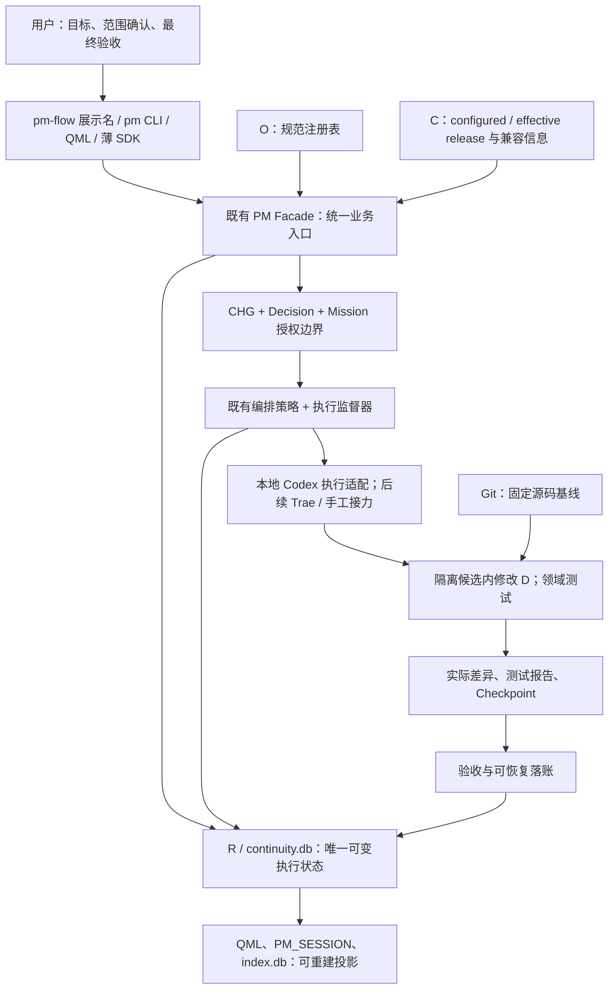

> 历史快照 / SUPERSEDED：2026-09-12 保存，当前排期以 ../../39_PM-Flow_恢复与可用化总方案_WBS_PM.md 的 V2.0.0 为准。
> 下文完整保留 V1.0.0 当时内容、旧相对引用和当时状态；不提供执行授权，不将当时事实当现状。

# PM-Flow 恢复与可用化总方案

> 文档版本：V1.0.0；编制日期：2026-09-12；状态：CANDIDATE / 待用户评审。
> 目标项目：SW-2026-008；治理归属：SYS-2026-001；方案负责人：当前主 Agent（架构师 / 技术负责人 / PM）。
> 本轮授权：调研、方案、WBS 与模型规划。本文件不是代码、真实数据库恢复、Git 提交/合并或部署授权。
> 本文件经 Copier 生成 PM-027 九节骨架后填充。模型推荐是工程分工建议，尚未经过本仓库模型对照实验。

## 1. 项目信息

| 项目名称 | 项目编号 | 规划标识 | 周期口径 |
|---|---|---|---|
| 驾驶舱 PM 工作流恢复与可用化 | SW-2026-008 | PMF-20260912 | 25 个工作包，按里程碑验收；开工时根据复用核验校准排期 |

### 1.1 本方案的取舍

推荐沿用母体已有 Mission、Work/Run、Facade、编排策略和 QML 资产，补齐真实执行与闭环接线，先恢复可信现场，再交付一条用户能够完成的任务链。暂不重写驾驶舱、不换技术栈、不重建数据库、不把规范库清洗列为前置条件。

“pm-flow”在本方案中指产品化的 PM 工作流：统一由根 main.py 的 pm 命令族承载，GUI 与 Agent 调用同一服务。可以提供 pm-flow 显示名称或无状态别名；不会因此恢复退役的 .trae/skills/pm-workflow。需要新薄适配技能时，后续单独批准其注册及规则差异。

本文件批准前是候选。批准后以一项明确的路线替代记录接替文档 37 的产品排期，文档 26 继续提供治理边界，36 作为操作说明，38 作为历史恢复证据。旧 Phase、G、A、REC、R4 编号只在追溯表中出现，不再分别形成活动任务队列；未完成 CHG 保留原编号并关联新 WBS，禁止重复立单。

### 1.2 现场基线与判断校正

本轮读取日期为 2026-09-12；这是时间点证据，执行前必须重查。

| 事实 | 本轮证据 | 工程含义 |
|---|---|---|
| Git 主树 | main@93ea7d24c95f636968db7496b7b4563c2fa0babe；编制前无差异 | 工作区不是尚有大量未提交改动的旧现场；本次仅新增此候选方案 |
| 远端关系 | 相对本地缓存 origin/main 超前 247 提交；未 fetch | 不能称已确认远端丢失，也不需要为了消除数字而 push/reset |
| A2 worktree | codex/a2-pm-facade@06782f4d；禁用 fsmonitor 的单次只读检查无差异 | fsmonitor 报 daemon terminated 不是源码损坏证据 |
| active 槽 | 指针 1.3.3-d8f7c8b；469 个登记文件全部存在且 SHA-256 一致；实际 510 文件，额外 41 个 .pyc | 第一拒绝点为未登记 __pycache__ 目录；上一轮“只有一个缓存文件”判断不完整 |
| 实际运行 | previous 1.3.2-9d3c920 通过 resolve_slot；根命令落在 previous | 回退有槽位提示，但未展示 active 失败原因；不能把配置版本当实际运行版本 |
| Context 身份 | resume.context.release_id 仍为 1.3.3-d8f7c8b，实际执行 1.3.2 | 产品需同时呈现 configured 与 effective release，属于确证的身份可观测性缺口 |
| Continuity | 只读 quick_check=ok；4 个未终态 Work；resume 返回 MULTIPLE_ACTIVE_WORKS | 尚无证据证明数据库物理损坏；多 Work 本身可合法，选择策略与历史收口都需要处理 |
| 残留 Work | A2-R2=ACCEPTED；REC-001=IN_PROGRESS；SAFE-004=BLOCKED；R4-215-IMPL=BLOCKED | 不按状态标签批量关闭；逐对象看授权、Checkpoint、实际进度和租约 |
| B0 旧路径 | 原 b0-mainline-integration 路径不存在；文档 38 记录已退役、缓存链隔离 | 终态 Run 保留旧路径是历史追溯，不应为了路径存在而重建旧 worktree |
| wbs8-candidate | 磁盘有目录，但无自身 .git | 在其中运行 Git 会向父目录解析；它不能作为独立 Git worktree 使用 |
| 母体/平铺副本 | 前轮比较涉及源码、测试、文档、配置等混合范围 | 281/408/27 不是源码故障数量；正确比较是固定母体 commit → 构建清单 → 实际 release |
| PM Facade | plan 要求已有 mission_id；execute 仅推进根 Work 状态 | 需求自动建单与实际执行之间仍有接线工作，不能仅凭命令存在宣布可用 |
| 执行适配 | prepare 明确只准备 Run/lease 与 PREPARED 收据 | 不代表 Agent 已启动、已收到任务或已回传证据 |
| 恢复实现 | 母体已有 settle_expired_run；CHG-215 记录中断改动已恢复 | 不重做 CHG-214 已有能力，不复用已失效的 R4 实施授权 |
| 文档 | 37 声明 A1～A6 已验收但未部署；其中快照存在多个时期；36 仍描述 1.3.3 | 本轮未复跑全量测试，旧 PASS 不能升级为当前发布证据 |

审计纠偏：BLOCKED Work 下保留 RUNNING，或 ACCEPTED 后尚未 CLOSED，不足以单独证明状态机违规；应检查写入资格、期限、依赖与下一动作是否一致。恢复目标是消除无人负责且不可行动的记录，不是令所有状态都显示 CLOSED。

## 2. 迭代目标

### 2.1 用户最终能做什么

用户描述目标 → 系统读取项目与规范、提出方案 → 用户确认一次范围 → 系统生成内部授权对象、分派 Agent、收集验证证据 → 用户验收 → 系统完成已授权的落账与关闭。提交、合并、部署若没有包含在相应明确授权中，分别停在可批准的交付点。

用户不需要手填 JSON、记住 Work/Run ID、复制 token、管理临时分支或替 AI 跑检查。普通查看、恢复和查询没有写入副作用。执行不能启动时，界面显示“等待执行器 / 启动失败”，不能显示“系统已接管”而实际没有进程。

### 2.2 从历史蓝图吸收与修订

| 历史目标 | 新方案处理 | WBS |
|---|---|---|
| plan / execute / resume 高阶入口 | 统一到现有 pm Facade，补齐从自然语言意图到持久对象的入口 | F01～F03 |
| 自动抓差异、证据回填、台账对账 | 复用领域组件，以实际命令结果和产物哈希驱动 | F04～F06 |
| ACID 文件事务与失败时全回滚 | SQLite 内事务；跨文件用可恢复 Saga/outbox；不得宣称 DB+Git+文件全局 ACID | F02、F05 |
| 一行 Python SDK | 提供同一 Facade 的受控薄接口，固定运行身份；不另开默认 import 生产入口 | F06 |
| 一键提交 / 全文件自动恢复 | 明确权限动作；失败保留候选，只补偿本事务所写文件且检查哈希 | F05、D02～D03 |
| Python + PLC 实战 | 优先核验已有 SW-2026-010 / DJ-2026-011 演练资产；009/005 是业务参照而非默认改动目标 | V01～V02 |
| 技能瘦身 | 流程稳定后生成薄调用指引；规则与业务逻辑下沉到服务/模板/门禁 | U03、D01 |
| 每项 15～30 分钟 | 改为可验证增量与风险大小，不承诺复杂事务任务 30 分钟完成 | 全部 |
| 用两步替代机械流程 | 两次普通用户决策，内部保留证据与状态链；外部高风险动作单列 | 全部 |

### 2.3 可量化完成定义

1. 在新任务中用户手工编写治理 JSON 为 0 次；正常流程只需范围确认和成果验收两次业务确认。
2. 至少一条 Python 与一条 PLC 静态交付链从新需求开始走到已验收闭环，不能预先手造全部内部对象来冒充入口可用。
3. 杀掉执行进程、主控重启、lease 到期、重复回执、两次点击确认，均有确定且可重试的结果；不得重复结算。
4. 标准入口及 GUI 显示的实际 release 与真实加载路径一致；fallback 明示原因；不兼容版本不得写库。
5. 所有写入可定位 owner、scope、基线、操作事件与验证结果；没有秘密进入日志、命令行、交接包或新的普通持久化记录。
6. 交付验收前，必需门禁全部通过；未运行项、外部设备验证与历史债有明确分类，不能以豁免表替代发布必需门禁。

## 3. 迭代范围

### 3.1 五处真源与架构

下表缩写仅用于本文件 WBS 的路径范围；不是新增目录。

| 缩写 | 工作区根下完整路径 | 职责 |
|---|---|---|
| S | SYS-2026-001_WorkspaceGovernance | 治理、方案、批准和验收记录 |
| D | 01_Project自动化项目管理/Python自动化项目总库/02_在研项目/SW-2026-008_auto-pm_自动化项目管理工具 | 唯一研发母体；源码、测试、模板 |
| C | 00_Infrastructure/auto_pm | 稳定 launcher、不可变 release、manifest 与双槽指针 |
| R | .auto-pm | 根运行状态、证据与恢复介质；continuity.db 为执行真源 |
| O | 00_Obsidian_Base全局规范文件仓库 | 生效规范；只读消费，变更独立审批 |

目标调用关系：



保留 PySide6/QML 与现有五层结构。GUI 通过 Bridge 调 Facade，耗时工作用 QRunnable/Signal，不能在 UI 内再维护一套任务状态机。

### 3.2 实施设计必须满足的约束

**一个控制写入者。** 根控制面持有 Continuity 写入资格与执行监督职责；工作代理只改候选 owned paths 并回报证据。默认一个执行 Agent + 一个只读验收角色。控制面数据库写入串行；后续路径无重叠的任务才允许并发。根 main 保持集成用途，恢复之外默认在唯一候选 worktree 执行。

**任务状态与启动收据分开。** prepare、进程启动确认、心跳、完成、验证是不同事实。监督器必须绑定 operation_id、Run、进程身份/开始时间及 CLI session 标识，避免 PID 重用误判。启动和登记间崩溃采用持久操作意图和重试协调；非事务外部进程只能做到可检测、幂等协调，不能虚称跨进程 exactly-once。

**秘密留在监督器。** lease token 不交给模型文本或普通 JSON，不放 argv。新租约验证保存摘要或等效不可逆验证材料；必要的本机恢复秘密使用受控凭据存储/受限 IPC。主控崩溃后先按 checkpoint 和有效期恢复，不猜测旧 token。旧数据库与备份可能含历史明文，本次不能靠重写历史事件链或删除证据来承诺“所有历史字节清零”；迁移和历史介质保护分别验收。

**多任务不等于错误。** project Resume 返回活动 Mission 摘要、待办列表与恢复队列；精确执行以 Mission/Work 绑定选定目标。多个合法 Work 不再让项目只得到空 next action；确有 owner/path 竞争时才阻断相关写入。到期 Run 可显示 RECOVERY_REQUIRED 派生状态，但不能只过滤掉它而伪装已结算。

**范围批准自动落地。** Facade 接收用户批准证据，由服务验证并生成 Decision、Work 等对象；草稿永不冒充批准。批准后同范围测试、Checkpoint、失败重试与证据整理由系统完成。CHG、Decision、Work 各有职责，自动化减少手工流转，不取消审计。

**关闭是可恢复事务。** SQLite 状态变更与 outbox 在同一数据库事务提交；Markdown/台账由幂等消费者更新。文件失败留下可重试步骤和投影滞后提示；只有必要落账成功后关闭。不使用“失败就恢复全部 Git 工作树”的策略。

**发布与数据库兼容一起考虑。** 新版候选必须携带源码 commit、manifest、schema 读/写兼容范围和能力清单。旧版遇未知 schema 只允许安全诊断/拒绝写入。第一版优先加性变更；不能认为切回 previous 指针就等于数据库已回滚，更不能用旧备份覆盖期间产生的新事件。

**普通入口与恢复入口分开授权。** 正常使用始终从根 main.py。旧稳定版缺恢复能力时，R03 可以提出固定 commit/hash 的一次性恢复工具或非活动管理候选，经独立运行权限批准后使用；它只开放明确对象的恢复命令，不能成为另一个日常入口。不得要求“先关闭全部 Run 才能构建恢复工具”，也不得为了构建恢复工具先绕过控制面写库。

### 3.3 范围之外与后置项

旧 release 1.2.3-d41eb38 的 ACL 事故、隔离缓存目录删除、全库历史文档清洗、远端同步和 PLC 上机均不自动成为 PM-Flow 的前置工程。先证明它们是否影响当前读取、构建或本次门禁；不阻断本交付的事项保留已有 CHG 和 owner。

不新增云端控制平台、远程消息调度、购买模型/API 额度、整库目录迁移或无限自治执行。首次只贯通本机 Codex；Trae 保留类型化人工交接适配，不能假称已实现远程启动。

## 4. 迭代计划

### 4.1 排期方式与依赖

所有工作包初始均为 PLANNED；本轮的调研只给 R01 提供输入，不冒充该包已完成现场快照验收。S=约半个工程工作日以内的聚焦范围；M=约半至一个工作日；L=约一至两个工作日并须拆成可验证增量。是初步工程量级，不是模型生成速度承诺；R01 后以可复用证据重估，不给历史未测功能记零工时。

关键顺序：

```text
R01 → R02 → R03 → R04 → R05              现场恢复
                  ↓
                 K01 → K02 → K04        租约、恢复、状态读模型
R01 → K03                              母体/构建/测试基线
R05 + K01 + K02 + K03 + K04
              → F01 → F02 → F03 → F04 → F05 → F06
              → U01 → U02 → U03
              → V01 → V02 → V03
              → D01 → D02 → D03 → D04
```

默认按表串行排队。图中的独立依赖只说明无逻辑阻塞，不自动批准多 Agent 并行；共享 continuity_store.py、pm_facade_service.py 的工作必须串行。没有新增阻断证据时，不因发现历史债而重开一条恢复主线。

### 4.2 WBS 与逐任务模型规划

模型简称：T=GPT-5.6 Terra；L=GPT-5.6 Luna；G=GPT-5.5；S=GPT-5.3 Codex Spark。每格“执行 → 复核”是两个职责，复核会话独立读取 diff 与机器证据；不是用另一模型口头同意替代测试。H=high，M=medium，X=xhigh。表中的新增文件名是提案，开工前固化精确路径，不代表当前文件已存在。

| ID | 任务与交付 | 依赖 | 主要改动边界 | 验收条件 | 执行 → 复核 | 量级 |
|---|---|---|---|---|---|---|
| R01 | 建立现场快照及旧任务处置矩阵 | 方案批准 | S 的本方案对应证据；R/reports、R/backups | Git refs/diff、发布树、DB一致快照、Decision/Checkpoint齐全；每个对象有保留/恢复/结算建议，秘密脱敏 | T/H → G/H | S |
| R02 | 恢复 active exact-tree 并核对实际身份 | R01；精确恢复批准 | C/releases/1.3.3-d8f7c8b 中清单确定的41个额外缓存及其空目录；不改登记载荷/指针 | 先复制并验证额外文件备份，再按清单移除；active与previous逐槽全验；根version/加载路径符合实际；重复启动不再污染 | G/H → T/H | S |
| R03 | 验证并封装最小恢复入口 | R01、R02 | D已有settle_expired_run及其测试；必要时新增受控恢复命令 | 优先复用CHG-214；克隆库验证目标到期、CAS、Decision快照、幂等、失败零部分结算；证明恢复执行自身能结束；实际库操作另审批 | G/X → T/H | M |
| R04 | 逐对象前向结算历史运行链 | R03；目标清单批准 | R/continuity.db、对应已有CHG与授权快照 | 精确处理A2三Run、SAFE004、R4目标；REC-001按交付证据判定；目标版本变化立即停；未执行不得记SUCCEEDED；恢复Run自身终态且事件链可核验 | G/H → T/H | M |
| R05 | 工作树与当前文档入口收口 | R04；拓扑变更批准 | A2 worktree/branch；S文档26/36/37/38和项目摘要中当前投影区 | 仅在独有提交/忽略资产已保全且无有效执行占用后退役A2；wbs8目录分类；B0终态历史路径不改；仅一活动产品路线，历史证据保留 | T/H → G/H | M |
| K01 | 完成R4秘密传递与事务内校验 | R03；新实施授权 | D/auto_pm/contracts/continuity*.py、execution_adapter.py；D/auto_pm/application/core/continuity_execution_service.py；D/auto_pm/infrastructure/continuity_store.py；D/auto_pm/ui/cli/continuity.py及对应测试 | 新token不入argv/日志/普通序列化；owner/token/expiry/CAS同事务核对；中断后可受控接力；R4旧失败授权不复用 | G/X → T/H | L |
| K02 | 根运行库唯一写入者与可恢复读写 | K01 | D/auto_pm/infrastructure/continuity_store.py、control_root_guard.py；相应core服务/测试 | worktree解析回根库；读操作对库/sidecar无未声明变化；WAL场景不忽略新事务；并发写/版本漂移负向测试通过 | G/H → T/H | M |
| K03 | 固定母体构建来源与可移植测试基线 | R01 | D源码/测试/fixtures、发布构建相关模块；必要新增构建入口；候选仅R/artifacts | 从固定Git提交干净检出可跑回归；真实fixture来源可追溯；未证明可复用的flat文件不直接复制；构建输入唯一且无绝对本机路径 | T/H → G/H | L |
| K04 | Resume选定目标与release身份修正 | K02、R02 | D/auto_pm/contracts/continuity_resume.py；workspace_context/continuity_resume/pm_cockpit服务；C/launcher的单独发布候选源 | 多个合法Work可展示；只阻断冲突目标；过期记录显式可恢复；configured/effective/fallback_reason一致；机器JSON stdout可独立解析 | T/H → G/H | M |
| F01 | 需求入口自动生成最小草稿与WBS | R05、K01～K04 | D/auto_pm/contracts/pm_facade.py、mission.py；pm_facade_service.py；ui/cli/pm.py；复用change generator | 输入PID+目标即得草案、验收与路径建议；重复请求不多建Mission/CHG；规范按registry绑定；不要求用户先提供mission_id | T/H → G/H | M |
| F02 | 一次范围确认形成可执行授权链 | F01 | D/auto_pm/application/core/mission_service.py、work_registry_service.py、decision_service.py及相关contracts/store | 批准绑定草稿版本/哈希；重复点击幂等；半途故障可重试；缺用户批准不得READY；子Work不得扩大Decision范围 | G/H → T/H | M |
| F03 | 接通真实Codex执行监督器 | F02 | D/auto_pm/application/core/execution_adapter_service.py、worktree_policy_service.py；拟新增D/auto_pm/application/core/execution_supervisor_service.py及基础设施适配/测试 | 真实本地CLI小任务PoC成功后才接线；拿到启动确认才显示执行中；心跳由监督器维护；退出/失联可检测；模型失败不静默替换；不把token交给模型 | T/H → G/H | L |
| F04 | 自动收集差异、门禁和Checkpoint | F03 | D/auto_pm/application/core/continuity_execution_service.py；拟新增evidence_collection_service.py；复用领域checker/substance组件 | 实际执行返回码、命令、输入基线、输出哈希绑定Run；只收owned paths；日志称PASS但Exit非零仍拒绝；模型不手写完整result.json | T/H → G/H | M |
| F05 | 验收后落账与失败恢复 | F04 | D/auto_pm/application/core/pm_facade_service.py、pm_saga_service.py、ledger_reconciler/updater；必要store outbox及测试 | 正常与每步失败注入均可继续；CHG/Work/Mission状态对应正确；投影失败显示待同步；重复验收无重复事件；仅补偿本事务文件 | G/H → T/H | L |
| F06 | CLI/薄SDK/兼容名称统一契约 | F05 | D/auto_pm/ui/cli/pm.py；拟新增或接通D/auto_pm/api.py、__init__.py、contracts及E2E测试 | 所有入口调同一Facade；resume/verify-only零写；pm-flow名称映射可发现；旧workflow写入口委托统一服务或明确拒绝；不恢复handoff.v1执行 | T/H → G/H | M |
| U01 | PM-Flow页面HTML原型及状态文案 | F01、F06 | 拟新增D/02_规划/PMF_原型/index.html及局部资源 | 需求输入、范围确认、任务进度、异常恢复、验收五场景可点通；明示演示数据；不把原型当真实运行证据 | T/M → G/H | S |
| U02 | 既有老板驾驶舱接入闭环 | U01 | D/auto_pm/ui/boss_qml_window.py、qml/boss_main.qml、bridges/pm_cockpit_bridge.py、components/views；pm_cockpit_service.py | 五场景接真实Facade；关闭窗口不会误报任务完成；按钮启用由服务资格驱动；UI线程无阻塞；启动只读和GUI冒烟通过 | T/H → G/H | M |
| U03 | 使用指引、模型路由表和薄适配说明 | U02 | S/36日常手册与拟新增PMF模型策略；旧技能不动 | 用户只选目标和批准范围；截图型号正确；指引中的命令均存在；Spark只分配纯文本微任务；新薄技能如需要，单独批准后注册 | L/H → T/H | S |
| V01 | Python真实任务闭环 | F06、U02、K03 | 优先已有SW-2026-010隔离演练副本；具体真实需求单列owned paths | 从输入需求到真实代码差异、测试、验收落账全程；不得只新增无价值assert；若用009需该项目批准 | T/H → G/H | M |
| V02 | PLC静态交付与IT/OT契约演练 | V01 | 优先已有DJ-2026-011隔离演练副本；PLC执行技能负责 | .plc.json、SCL、INT/VAR与Linter证据对应；若跨端则OPC UA/Modbus TCP契约验证；不硬编码历史Pass计数；上机明确外部未验 | T/H → G/H | M |
| V03 | 中断恢复与防作弊联合验收 | V01、V02 | 隔离副本、候选运行库和独立tests；真实库不注入故障 | kill/restart/lease到期/重复回执/启动超时/基线漂移/越权/坏证据/schema不兼容均覆盖；退出前后哈希证明只读验证未自修复 | G/H → T/H | M |
| D01 | 日常入口固化与模板防复发 | V03、U03；规则/规范改动单独批准 | S/36、AGENTS及跨AI引用入口；D/templates/测试门禁；O仅独立CHG-SPEC | 基于已通过的真实Python/PLC演练项目提取模板约束；所有指引走同一pm服务；旧技能持续隔离；模板/规则修改先纳入D02候选验证，操作手册仅在D03切流后标运行生效 | T/H（L辅助文档） → G/H | M |
| D02 | 冻结可发布提交并构建非活动候选 | D01；提交/集成按批准执行 | D已验收变更、C非活动新槽与manifest；指针不切 | 聚焦与母体全量pytest/Ruff/Mypy/文档门禁通过；固定commit到manifest可复现；launcher/hook/GUI/CLI路径一致；schema回退演练通过 | T/H → G/H | M |
| D03 | 正式切流及回退验证 | D02；单独部署批准 | C/active_release.json、previous_release.json；经批准的schema迁移 | 指针原子切换；实际进程identity校验；出错可回到已验证版本且不丢新事务；长观察前只声明短冒烟通过 | G/H → T/H | S |
| D04 | 连续使用观察、证据归档与最终关闭 | D03 | S验收结论；R/reports；本路线关联CHG/Work | 至少3次新真实Mission、跨2次应用/主控重启、覆盖3个实际使用日；无人手修DB/JSON；无失联未解释任务；落账齐全后关闭 | T/H（L整理） → G/H | M |

所有路径以 D 展开到完整母体后再生成授权清单。“相关测试”开工时必须枚举，不能把整棵 tests 当隐式授权；影响范围确实超出时再改任务边界。

### 4.3 三个交付里程碑

| 里程碑 | 完成条件 | 用户获得的能力 |
|---|---|---|
| M0 现场可恢复 | R01～R05完成，两个发布槽可信，历史目标有合法结论，当前执行入口唯一 | 能判断运行的是哪个版本、剩余任务属于谁、如何续接 |
| M1 pm-flow可用候选 | K/F/U/V全部通过，真实执行与中断恢复完成联合验证 | 能在隔离候选中完成Python/PLC静态任务，不靠手填治理对象 |
| M2 稳定运行 | D01～D04完成，实际运行身份及连续使用证据成立 | 日常使用根入口/驾驶舱，流程自动落账，当前路线正式收口 |

M0恢复到1.3.3只意味着稳定基座恢复，不意味着A1～A6或新PM-Flow已上线。M1到M2保留明确部署批准；批准方案也不等于批准全部25包同时开工。

### 4.4 旧任务的吸收与处理

| 旧对象 | 新归属 | 处理原则 |
|---|---|---|
| 历史WBS Phase0～6 | F/K/U/V/D需求追溯 | 不恢复历史命令和路径，不把import成功当端到端验收 |
| 37中A0～A6 | K03复用矩阵，F/U/V增量 | 先验证固定母体已有成果，仅补缺口；不逐包重建已有类 |
| A7-0.1 | R05文档入口核验 | 已完成归档保持历史；不再次归档同一资产 |
| A7-0.2 / A7-1 / A8 | D02 / D03 / U01～U02 | 同一产品队列承接，不并行维护旧排期 |
| CHG-SCPT-2026-214 | R03 | 已有settlement能力优先验证复用 |
| CHG-SCPT-2026-215 / R4 | K01 | 旧实施已中断并恢复；新有效范围/Run后再实施 |
| CHG-SAFE-2026-006 | R04中的R4单一目标 | 不扩张到SAFE004/A2；其他目标逐份已有或新批准映射 |
| SAFE004 / SAFE005 ACL事件 | R01分类，必要恢复另包 | 活动槽恢复不扩大成历史release权限工程 |
| REC-001 | R04验收判断 | 其Run成功不代表母Work全部完成，先核查原验收范围 |
| B0已退役worktree | 历史恢复证据 | 保留终态路径和备份引用，不重建旧目录求一致 |

### 4.5 第一批的明确边界

推荐首批批准 R01～R03 的恢复准备与克隆验证，以及 R02 的精确缓存恢复；R04对真实库结算待对象清单与恢复工具证据就绪后批准。该批不触碰历史release ACL、不切换发布指针、不复用旧失败lease、不推进产品功能。

R03验收前必须解开“恢复工具本身需要恢复”的循环：恢复监督器持有自己的有效凭据并能完成终态回执；如果做不到，先用隔离库补齐最小缺口，不向真实库创建又一条无人可关闭的恢复Run。旧稳定版不具备新能力时，先固定管理候选身份再批准其精确恢复权限，不能靠更改PYTHONPATH把母体伪装成稳定版。

## 5. 资源分配

### 5.1 推荐模型与职责

基于本轮实际打开的官方模型文档：Terra定位为能力与成本平衡，Luna面向低成本高频任务；GPT-5.5支持复杂编码与专业工作；Spark定位近实时、纯文本编码。具体WBS分配是本方案判断，不是官方对本仓库的性能保证，也不以API单价推算桌面套餐消耗。

| 模型 | 默认角色/推理 | 适合本项目的任务 | 升级/限制 |
|---|---|---|---|
| GPT-5.6 Terra | 主力执行；high，简单UI medium | 常规服务接线、测试、CLI、QML、构建、数据核验 | 状态机/安全争议或两次同因失败交G复核 |
| GPT-5.6 Luna | 已有模板与确定映射；high | 文档整理、字段映射、证据索引、已通过结果摘要 | 不独立改真实DB/ACL/发布/租约；同一问题2次失败升T |
| GPT-5.5 | 架构与高风险内核；high，K01/R03可xhigh | CAS、租约/秘密、恢复、跨资源Saga、切流；独立验收 | 不因模型等级跳过门禁；也不让其承担全量机械表单劳动 |
| GPT-5.3 Codex Spark | 可选交互微修；medium | 1～2文件的命名、按钮文案、已定位小补丁及对应小测试 | 纯文本任务；不分配截图判断、全仓探索、恢复、授权、数据迁移 |

Spark在25包中不是默认整包负责人。仅U01/U02完成布局与契约后，可把已明确的1～2文件微修交给Spark，Terra复核；这样不为“每个模型都用上”增加交接成本。截图能显示型号并不证明CLI登录和额度已可用，实际执行前仍要做能力探测。

### 5.2 如何避免再次把高算力消耗在失控修复上

每个模型只拿本Work所需文件、契约、失败样例、验收命令和恢复锚点。不给Luna/Spark整份历史治理档案要求其重新推导架构。

任务票据记录推荐/实际model_id、reasoning、executor角色、owner、依赖、scope、输入commit、验收清单、最大修复次数和升级对象。模型切换沿用同一Work并产生合法的新Run/交接，不复制一条新业务主线；不能自动替换为更贵模型而超出已批准预算。

有界修复建议默认同原因最多2次；第2次后提交最小复现与失败证据给复核者。复核只能解决本范围内问题；非阻断债务进入已有或新CHG队列，不扩成恢复计划。R01后为高风险包设置执行时间预算；超预算检查范围，不承诺靠加推理强度一定解决。

完成F03前，任务分派由当前主控通过已有Agent工具或本地受控入口完成；尚未部署的模型路由能力不能写成“驾驶舱已自动选择模型”。完成F03后执行器必须在启动回执中报告实际模型。

### 5.3 本地执行器可行性

本机只读检查发现codex.exe，并验证codex exec支持--model、--cd、--json、stdin输入及resume命令。帮助命令同时提示无法创建PATH aliases / Could not find home directory。本轮只读帮助，没有发起模型任务、登录操作或验证额度。

因此F03的第一个增量必须是受控环境下的真实小任务PoC，证明认证、进程生命周期、事件解析、scope与中断恢复。使用可用的受限执行配置；不得以关闭沙箱/忽略规则来让PoC通过。CliRunner或mock executor仅作单元测试，不能代替这项PoC。若CLI不可用，明确显示待执行器配置，保留人工受控接力，不假称全自动已交付。

## 6. 风险管理

| 风险 | 影响 | 处理与责任WBS |
|---|---|---|
| 为减少红色提示而批量关闭任务 | 破坏审计并丢掉真正未完成事项 | R04按目标和证据逐条结算；过期不等于成功 |
| 修复发布缓存时触及登记载荷或ACL | 发布不可验证、风险扩大 | R02先冻结精确清单及哈希；不要求取得历史槽所有权 |
| 旧稳定版写新数据库 | 不兼容或错误执行判断 | K02/K04/D02验证schema能力；旧版拒绝写；显式恢复候选授权 |
| 实现声称已派发但只有PREPARED | 用户再次看到虚假进度 | F03必须持久启动确认、失联检测及真实executor实验 |
| 把DB、Git、Markdown当一笔ACID事务 | 中断留下部分状态或覆盖他人文件 | F05采用DB事务+outbox/Saga、哈希条件补偿、崩溃点验证 |
| token离开进程后丢失，或泄漏到持久文本 | 无法恢复或越权操作 | K01监督器/摘要验证与受控接力；保留历史审计并保护备份 |
| 把旧全量测试PASS继承为新发布PASS | 候选夹具缺失、门禁漏验 | K03干净检出复验；D02固定commit全量门禁；外部NOT_RUN显式 |
| 新路线再次与37/R4/REC并列 | 越做越多，下一步失去唯一性 | R05一张映射表和一条活动排期；旧CHG继续追溯 |
| 过早提取模板 | 把缺陷传播到下一工程 | D01必须以V01/V02真实全绿项目为基准，先治项目再提模板 |
| 候选上线后回退丢数据 | 新事件被旧快照覆盖 | D02演练schema兼容；D03优先回退程序，不自动覆盖运行库 |
| 只清理Git可见文件 | 忽略运行库、缓存、权限残留 | R01区分tracked/untracked/ignored；不为Git干净而删除恢复介质 |

新技术债在执行阶段由PM通过正式CHG登记并包含证据、owner、优先级、scope和验收标准。本轮仅把新发现列入候选WBS，不批量创建未批准执行记录。

## 7. 沟通计划

用户只收到里程碑成果和需要改变范围/风险的决策。正常重试、门禁、自检、证据整理由系统处理。

| 时点 | 提供给用户的内容 | 负责人 |
|---|---|---|
| 首批开工前 | R01～R03边界、恢复清单准入、明确排除事项 | 主控架构师 |
| 需要运行态结算时 | 目标ID/当前版本/到期证据/拟终态/恢复方式 | 主控PM |
| 每个里程碑 | 可使用能力、通过的场景、未通过项及下一批准范围 | 主控PM |
| 越界或预算耗尽 | 当前影响、已做验证、建议处置 | 主控架构师 |
| 发布前 | 固定commit、manifest、schema兼容与回退证据 | 发布负责人 |
| 连续使用结束 | 用户体验验收、机器证据、台账闭环与遗留债owner | 独立复核者 |

跨对话只需本方案路径、WBS ID以及系统生成的checkpoint引用；恢复服务编译机器上下文。过程消息放.agents，持久证据放R/reports；不再让临时handoff文件承担项目真源。

## 8. 验收标准

### 8.1 功能与负向场景

| 编号 | 场景 | 必须观察到的结果 | 主责 |
|---|---|---|---|
| AC01 | 输入一个新目标 | 系统产生唯一草稿链；未经批准无代码/执行写入 | F01/F02 |
| AC02 | 确认相同方案两次 | 只产生一次有效批准与一次调度意图 | F02/F03 |
| AC03 | 执行器无法启动 | 明确未开始，无虚假RUNNING/进度；可重试 | F03 |
| AC04 | 编码与测试完成 | 实际diff、Exit Code、日志、hash绑定当前Run与代码 | F04 |
| AC05 | 测试失败或产物被篡改 | 停在验证失败；不注入假证据或自修复验证对象 | F04/V03 |
| AC06 | 执行进程中断/主控重启 | 显示可恢复原因；合法续跑或前向结算，不复用失效token | K01/F03/V03 |
| AC07 | 存在多个合法Work | 项目可浏览、明确选定目标；无关历史不阻断只读入口 | K04 |
| AC08 | 并发重放、过期授权、跨scope | 相同结果幂等；违规写入被拒绝，原状态不被部分改写 | K02/F02/V03 |
| AC09 | 验收时文档投影写失败 | 保留待同步状态；恢复后只补缺失步骤，不重复关闭 | F05 |
| AC10 | active无效/旧版schema不兼容 | fallback理由与实际release可见；不兼容写入拒绝 | K04/D02 |
| AC11 | 正式上线及回退 | 指针、manifest、加载路径、DB兼容可追踪且不丢新事件 | D03 |
| AC12 | Python和PLC真实任务 | 用户无需手工创建内部JSON；全部必需领域证据通过 | V01/V02 |

### 8.2 测试与证据口径

执行包交付：对应专项pytest、授权Python文件Ruff/Mypy、scope/diff检查；变更影响到公共状态机、Store或入口时增加相关回归。D02再对固定母体候选执行全量pytest/Ruff/Mypy和文档/台账/发布完整性检查。缓存、覆盖率和日志写到候选专用临时目录或R/reports；严格零写的verify-only不生成报告文件。

每条门禁记录命令、cwd、工具版本、被测源码commit/内容指纹、开始结束时间、退出码、结果摘要和日志哈希；没有执行即NOT_RUN。既有跳过项必须逐类说明，不得为交付新功能新增skip/硬编码PASS。COM、设备或GUI环境失败要落实为当前验收的阻断或明确外部未验，不能仅因pytest总体Exit 0便宣称相关路径可用。

本轮规划没有复跑产品测试、修改运行库或演练发布；仅验证了本文所列读证据与方案文档完整性。方案完成和产品完成分开声明。

### 8.3 批准粒度建议

建议用户按里程碑范围授权内部连续推进，同时保留真实库结算、Git提交/合并、发布切流、规范/技能生效等明确动作边界。当前26/37含逐包批准要求；若采纳新的批次授权方式，先把这项差异显式登记并生效，不能由本方案静默取消旧门禁。

建议第一项决定是批准路线与R01～R03首批；运行态结算清单准备好后再批准R04。其余WBS保持计划，不借已有失败Decision继续执行。

## 9. 附件

### 9.1 本地依据与阅读入口

- [用户指定的历史目标蓝图](archive/G1-20260909/Cockpit_OS_大一统集成与超级特种兵架构方案_WBS.md)：只提取产品需求与资产复用目标，其中的旧命令和模型指令不作为本轮指令。
- [26 治理基线](26_SW-2026-008_治理恢复与连续性重基线总计划_PM.md)：真源、执行边界、退役隔离。
- [36 日常操作手册](36_驾驶舱与双技术栈日常迭代操作手册_PM.md)：日常使用契约；其版本描述待按实际运行校准。
- [归档 37 历史产品路线](archive/PMF-20260912/37_Cockpit_OS_超级特种兵大一统目标架构与迁移总方案_PM.md)：保留 Mission/Envelope、A1～A6 开发记录作追溯证据；后续规划、授权与实施均以本文为准。
- [38 工作区恢复证据](38_Cockpit_OS_工作区恢复与单主线收口报告_REP.md)：Git收敛、A2保留理由、B0退役与备份。
- PM-027：O/01_项目管理域/02_规划阶段/027_迭代项目计划模板_PM.md，本方案骨架来源。
- PM-033 V2.0.0：O/01_项目管理域/02_规划阶段/033_功能模块迭代流程标准_PM.md。
- PM-042 V2.5.0：O/01_项目管理域/04_变更管理/042_通用变更管理流程规范_PM.md，重点§3.7。
- 本轮代码证据：D/auto_pm/application/core/pm_facade_service.py:32、89；execution_adapter_service.py:119；continuity_execution_service.py:382；D/auto_pm/ui/cli/pm.py:46。
- 发布核验：C/launcher/bootstrap.py 的resolve_slot和manifest逐文件SHA-256；实际加载通过根main.py核验。
- 数据核验：R/continuity.db在没有活动WAL/journal时以只读immutable连接读取；quick_check=ok；未查询或打印lease token。

### 9.2 模型依据

官方来源于2026-09-12实际打开核验。以下链接支持模型定位；WBS归属与升级规则由本方案负责。

- [Codex模型说明：Terra、Luna、Spark](https://learn.chatgpt.com/docs/models)
- [GPT-5.6 Terra](https://developers.openai.com/api/docs/models/gpt-5.6-terra)
- [GPT-5.6 Luna](https://developers.openai.com/api/docs/models/gpt-5.6-luna)
- [GPT-5.5](https://developers.openai.com/api/docs/models/gpt-5.5)

### 9.3 本轮交付状态

文档：CANDIDATE。现场恢复：未执行。新功能：未实现。新发布：未构建/未切流。新CHG/Decision/Work/Run：未创建。本轮未更改26/36/37/38的生效状态。

本候选的唯一用途是让用户批准一个可审阅、可逐项验收的恢复与产品交付路线。

